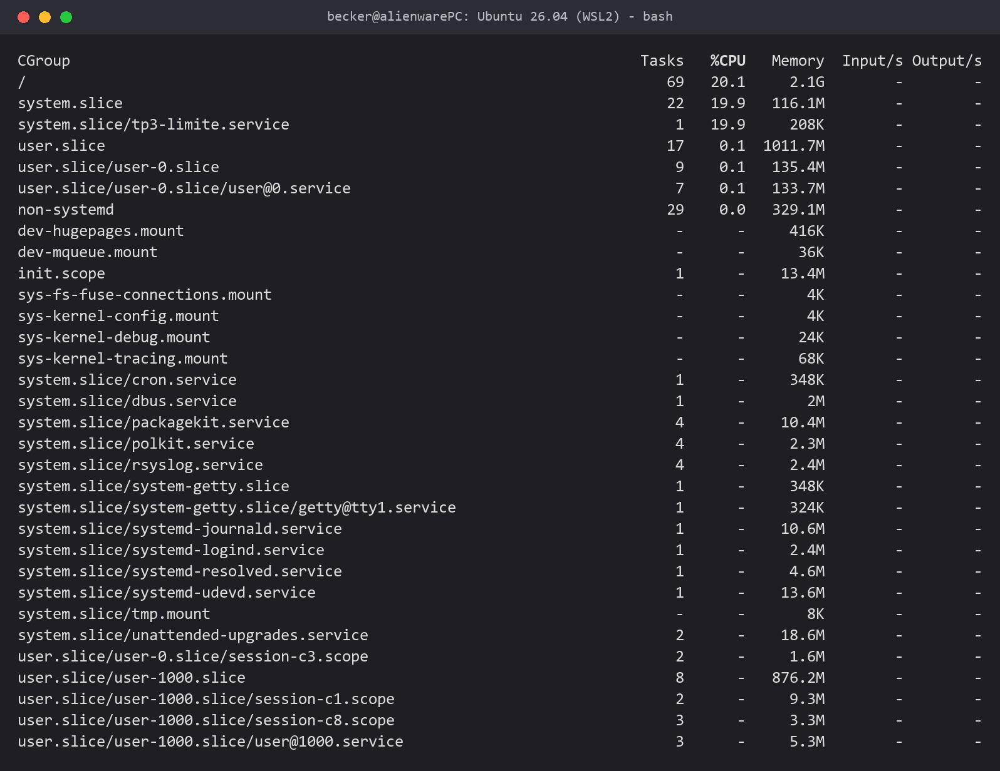

<div align="center">


# 🐧 Aplicativos, Serviços, Pacotes e Containers no Linux

**Executáveis, boot, systemd, apt, namespaces, cgroups, vi e Docker pela linha de comando, no bash do Ubuntu**

<sub>DR2-TP3 · Bloco Ciência da Computação · Trabalho individual</sub>

<br/>

[](docs/RELATORIO_TP3.md)
[](evidencias/DR2_TP3)

<br/>

[](#ambiente)
[](#ambiente)
[](#ambiente)
[](#ambiente)
[](#ambiente)
[](LICENSE)

<br/>



<sub>O <code>systemd-cgtop</code> com o serviço <code>tp3-limite</code> limitado a 20% de CPU pelo cgroup (Exercício 10).</sub>

</div>

---

<a id="indice"></a>

## 📚 Índice

| | O trabalho | | Qualidade e entrega |
|:---:|---|:---:|---|
| 01 | [Visão geral](#visao-geral) | 05 | [Atendimento à rubrica](#atendimento) |
| 02 | [Os 12 exercícios](#exercicios) | 06 | [Estrutura do projeto](#estrutura) |
| 03 | [Ambiente](#ambiente) | 07 | [Estado do projeto](#estado) |
| 04 | [Como foi feito](#como-foi-feito) | 08 | [Licença](#licenca) |

---

<a id="visao-geral"></a>

## 💡 Visão geral

Teste de Performance com 12 exercícios sobre o gerenciamento de aplicativos, pacotes, containers e
da inicialização do Linux, só pela linha de comando. Fiz todos no terminal do Ubuntu, no WSL2:

- **programas e boot:** comando interno, alias, script e binário; estado global do systemd, journal do boot e boot loader;
- **serviços:** inspeção, ciclo de vida (stop, start, restart) e inicialização automática com uma unidade própria;
- **pacotes:** busca, instalação e metadados com `apt`, e a cadeia de confiança dos repositórios;
- **isolamento e containers:** namespaces com `lsns` e `unshare`, cgroups com `systemd-cgtop` e limites reais, edição com o vi e um container Docker do Dockerfile ao `docker rm`.

Os prints foram copiados do próprio terminal no momento em que cada comando terminou, sem recorte
nem edição, inclusive as telas do Vim, do `journalctl` e do `systemd-cgtop`.

<p align="right"><a href="#indice">⬆ voltar ao índice</a></p>

---

<a id="exercicios"></a>

## 🧭 Os 12 exercícios

| Ex. | Tema | Comandos principais | Evidência | Detalhes |
|:---:|---|---|---|:---:|
| 1 | Executáveis | `which`, `type -a`, `file -L` | [ex01_executaveis.txt](evidencias/DR2_TP3/ex01_executaveis.txt) | [ver](docs/RELATORIO_TP3.md#exercicio-1) |
| 2 | Estado do sistema | `systemctl status`, `--failed` | [ex02_estado_sistema.txt](evidencias/DR2_TP3/ex02_estado_sistema.txt) | [ver](docs/RELATORIO_TP3.md#exercicio-2) |
| 3 | Boot no journal | `journalctl -b`, `systemd-analyze` | [ex03_boot_journal.txt](evidencias/DR2_TP3/ex03_boot_journal.txt) | [ver](docs/RELATORIO_TP3.md#exercicio-3) |
| 4 | Boot loader | `bootctl status`, `/proc/cmdline` | [ex04_bootloader.txt](evidencias/DR2_TP3/ex04_bootloader.txt) | [ver](docs/RELATORIO_TP3.md#exercicio-4) |
| 5 | Inspeção de serviço | `systemctl status`, `show` | [ex05_servico_rsyslog.txt](evidencias/DR2_TP3/ex05_servico_rsyslog.txt) | [ver](docs/RELATORIO_TP3.md#exercicio-5) |
| 6 | Ciclo de vida | `stop`, `start`, `restart` | [ex06_ciclo_de_vida.txt](evidencias/DR2_TP3/ex06_ciclo_de_vida.txt) | [ver](docs/RELATORIO_TP3.md#exercicio-6) |
| 7 | Boot automático | `enable`, `disable`, `daemon-reload` | [ex07_inicializacao.txt](evidencias/DR2_TP3/ex07_inicializacao.txt) | [ver](docs/RELATORIO_TP3.md#exercicio-7) |
| 8 | Pacotes | `apt search`, `install`, `show` | [ex08_pacotes.txt](evidencias/DR2_TP3/ex08_pacotes.txt) | [ver](docs/RELATORIO_TP3.md#exercicio-8) |
| 9 | Namespaces | `lsns`, `unshare` | [ex09_namespaces.txt](evidencias/DR2_TP3/ex09_namespaces.txt) | [ver](docs/RELATORIO_TP3.md#exercicio-9) |
| 10 | cgroups | `systemd-cgtop`, `systemd-run` | [ex10_cgroups.txt](evidencias/DR2_TP3/ex10_cgroups.txt) | [ver](docs/RELATORIO_TP3.md#exercicio-10) |
| 11 | Editor vi | `i a o O yy p dd u Ctrl-r / :%s :w :q` | [ex11_vi/](evidencias/DR2_TP3/ex11_vi) | [ver](docs/RELATORIO_TP3.md#exercicio-11) |
| 12 | Docker | `build`, `run`, `ps`, `images` | [ex12_docker/](evidencias/DR2_TP3/ex12_docker) | [ver](docs/RELATORIO_TP3.md#exercicio-12) |

<p align="right"><a href="#indice">⬆ voltar ao índice</a></p>

---

<a id="ambiente"></a>

## 🖥️ Ambiente

| Item | Configuração |
|---|---|
| Sistema hospedeiro | Windows 11 Pro |
| Linux | Ubuntu 26.04.1 LTS no WSL2, com systemd 259 como PID 1 |
| Kernel | 6.18.58.1-microsoft-standard-WSL2, x86_64, cgroup v2 |
| Editor | Vim 9.1 (`vim.basic`; neste Ubuntu `vi` e `vim` apontam para o Neovim) |
| Containers | Docker Desktop, motor 29.9 |
| Diretório de trabalho | `~/DR2_TP3`, copiado em [evidencias/DR2_TP3](evidencias/DR2_TP3) |

<p align="right"><a href="#indice">⬆ voltar ao índice</a></p>

---

<a id="como-foi-feito"></a>

## ▶️ Como foi feito

Os exercícios rodaram num tmux com duas janelas: um bash do usuário comum, para o que só lê o estado
do sistema, e um bash de root, para o que muda o estado (pacotes, serviços, namespaces e cgroups).
Cada comando foi digitado no terminal e executado de verdade, e cada tela foi extraída do buffer do
terminal (`tmux capture-pane`) e convertida em PNG sem edição. Os arquivos de evidência trazem a
transcrição literal de cada sessão e as conclusões. As ferramentas de captura e de montagem do
documento de entrega ficam fora deste repositório.

<p align="right"><a href="#indice">⬆ voltar ao índice</a></p>

---

<a id="atendimento"></a>

## 🎯 Atendimento à rubrica

| Critério | Onde está |
|---|---|
| Diferencia comandos internos, scripts e binários | Ex. 1 |
| Inspeciona o processo de inicialização | Ex. 2, 3 e 4 |
| Gerencia serviços com systemd | Ex. 5, 6 e 7 |
| Usa ferramentas de gestão de pacotes | Ex. 8 (e o Ex. 4) |
| Relaciona namespaces e cgroups a containers | Ex. 9, 10 e 12 |
| Cria e executa containers Docker | Ex. 12 |
| Usa o editor vi | Ex. 11 |
| Justifica decisões com evidências | Apresentação e resposta de cada exercício |
| Organiza e documenta os artefatos | `~/DR2_TP3`, um arquivo por exercício, e o anexo do PDF |

<p align="right"><a href="#indice">⬆ voltar ao índice</a></p>

---

<a id="estrutura"></a>

## 📁 Estrutura do projeto

```
linux_tp3/
├── LICENSE                  licença de código visível, com o aviso LGPD
├── docs/
│   ├── RELATORIO_TP3.md     relatório técnico, com os prints
│   └── context/             enunciado e rubrica
└── evidencias/
    ├── telas/               prints do terminal (44)
    └── DR2_TP3/             cópia de ~/DR2_TP3: os arquivos de cada exercício
```

<p align="right"><a href="#indice">⬆ voltar ao índice</a></p>

---

<a id="estado"></a>

## 📌 Estado do projeto

Os 12 exercícios estão executados e documentados, com as 44 telas e os arquivos de evidência. O
documento de entrega (`andre_becker_DR2_TP3.pdf`, com os prints e os arquivos no anexo) vai pela
plataforma do Infnet e não é versionado aqui.

<p align="right"><a href="#indice">⬆ voltar ao índice</a></p>

---

<a id="licenca"></a>

## 📜 Licença

Copyright © 2026 André Luis Becker. Todos os direitos reservados, sobre a contribuição original
deste trabalho.

Este repositório é **de código visível (source-available), não de código aberto**. É público para
ser lido, estudado e avaliado, e o corpo docente da instituição avaliadora pode executá-lo
livremente para conferir a entrega. Qualquer outro uso, incluindo clonar, executar, modificar ou
redistribuir, depende de autorização escrita. Os termos completos estão em [LICENSE](LICENSE).
