# Aplicativos, Serviços, Pacotes e Containers no Linux

> **DR2-TP3 · Bloco Ciência da Computação**\
> Disciplina: Sistemas Operacionais com Linux e Python\
> Trimestre: 26E4_2\
> Professor: Leonardo Silva da Gloria\
> Aluno: André Luis Becker\
> Sala: GRLENGR2C2-N2-L1\
> Repositório: [andrebecker84/dr2-tp3-linux-servicos-containers](https://github.com/andrebecker84/dr2-tp3-linux-servicos-containers)

<!--
Fonte do documento de entrega (o gerador fica fora do repositório). O que fica entre "so-github" e
"/so-github" e as seções "### Enunciado" aparecem só aqui, no GitHub. Em cada comentário
"arquivo: X" do anexo, o gerador insere no PDF o conteúdo integral de evidencias/DR2_TP3/X.
-->

<!-- so-github -->
> Relatório técnico completo. Cobre os 12 exercícios do [enunciado](context/enunciado-DR2-TP3.md) e
> os 9 critérios da [rubrica](context/rubrica-DR2-TP3.md). Cada exercício traz o enunciado, a teoria,
> os prints do terminal e a minha resposta. Os arquivos de evidência estão em
> [evidencias/DR2_TP3](../evidencias/DR2_TP3) e, no PDF de entrega, no anexo.

---

## Sumário

**Parte I · Contexto**
- [Apresentação](#apresentacao)

**Parte II · Programas e inicialização**
- [Exercício 1: Programas, comandos e executáveis](#exercicio-1)
- [Exercício 2: Estado global do sistema após a inicialização](#exercicio-2)
- [Exercício 3: Análise cronológica do processo de boot](#exercicio-3)
- [Exercício 4: Inspeção do boot loader](#exercicio-4)

**Parte III · Serviços com systemd**
- [Exercício 5: Inspeção detalhada de serviços](#exercicio-5)
- [Exercício 6: Controle do ciclo de vida de serviços](#exercicio-6)
- [Exercício 7: Inicialização automática de serviços](#exercicio-7)

**Parte IV · Pacotes, isolamento e containers**
- [Exercício 8: Gestão de pacotes e cadeia de suprimentos](#exercicio-8)
- [Exercício 9: Containers via namespaces](#exercicio-9)
- [Exercício 10: cgroups e controle de recursos](#exercicio-10)
- [Exercício 11: Manipulação de arquivos com o vi](#exercicio-11)
- [Exercício 12: Construção e execução de um container Docker](#exercicio-12)

**Parte V · Entrega**
- [Atendimento à rubrica](#rubrica)
- [Anexo: arquivos de evidência](#anexo)
- [Referências](#referencias)

---
<!-- /so-github -->

## Apresentação

Fiz os 12 exercícios no bash do Ubuntu 26.04.1 LTS, no WSL2 do Windows 11, só com ferramentas de
terminal. Os prints foram copiados do próprio terminal quando cada comando terminou, sem recorte nem
edição. Cada exercício gerou o seu arquivo de evidência, e todos ficam em `~/DR2_TP3`, reproduzidos
no anexo. O projeto completo é público no GitHub:

https://github.com/andrebecker84/dr2-tp3-linux-servicos-containers

| Ex. | Tema | Comandos principais | Evidência |
|---|---|---|---|
| 1 | Executáveis | `which`, `type -a`, `file -L`, `readlink -f` | `ex01_executaveis.txt` |
| 2 | Estado do sistema | `systemctl status`, `--failed`, `list-units --state` | `ex02_estado_sistema.txt` |
| 3 | Boot no journal | `journalctl -b`, `_PID=1`, `-u`, `-p warning`, `systemd-analyze` | `ex03_boot_journal.txt` e `ex03_boot/` |
| 4 | Boot loader | `bootctl status`, `/proc/cmdline`, `/sys/firmware/efi` | `ex04_bootloader.txt` |
| 5 | Inspeção de serviço | `systemctl status`, `systemctl show`, `ps`, `journalctl -u` | `ex05_servico_rsyslog.txt` |
| 6 | Ciclo de vida | `systemctl stop`, `start`, `restart`, `is-active` | `ex06_ciclo_de_vida.txt` |
| 7 | Boot automático | unidade própria, `daemon-reload`, `enable --now`, `disable` | `ex07_inicializacao.txt` |
| 8 | Pacotes | `apt search`, `apt install`, `apt show`, `apt-cache policy`, `dpkg -L` | `ex08_pacotes.txt` |
| 9 | Namespaces | `lsns`, `/proc/PID/ns`, `unshare` | `ex09_namespaces.txt` |
| 10 | cgroups | `systemd-cgtop`, `systemd-run -p CPUQuota`, `systemd-cgls` | `ex10_cgroups.txt` |
| 11 | Editor vi | `i`, `a`, `o`, `O`, `yy`, `p`, `dd`, `u`, `Ctrl-r`, `/`, `:%s`, `:w`, `:q` | `config_vi.txt` e `vi_operacoes.txt` |
| 12 | Docker | `Dockerfile`, `docker build`, `run`, `ps`, `images`, `stats` | `ex12_docker.txt` |

Decisões que valem para o trabalho todo:

- **Dois usuários, cada um no seu papel.** Os exercícios que só leem o estado do sistema (1, 2, 3, 5, 11 e 12) rodaram como o usuário comum `becker`. Os que mudam o estado (instalar pacote, parar serviço, criar unidade, criar namespace ou cgroup) exigem root. O `sudo` pediria a senha, que o roteiro não digita; por isso esses exercícios (4, 6 a 10) rodaram num shell de root aberto pelo próprio WSL (`wsl -u root`), o equivalente a um `sudo -i`. O prompt de cada print mostra quem rodou: `becker@...$` ou `root@...#`.
- **WSL2 explica vários resultados.** O WSL2 roda um kernel Linux real numa VM do Hyper-V, com systemd como PID 1. Não há firmware UEFI nem boot loader dentro da VM (Ex. 4), cada distribuição é ela própria um conjunto de namespaces (Ex. 9) e o Docker Desktop roda os containers numa distribuição interna da mesma VM (Ex. 12). Mostro cada caso com evidência, em vez de contorná-lo.
- **Nada fica quebrado.** O serviço parado no Ex. 6 volta a rodar, o `tp3-limite` do Ex. 10 é parado e o container do Ex. 12 é removido. Ficam no sistema, de propósito, o pacote `htop` (Ex. 8), o `systemd-boot-tools` (Ex. 4) e a unidade `tp3-saudacao` habilitada (Ex. 7), que é o estado final pedido.
- **Um arquivo de evidência por exercício.** Cada `.txt` traz o cabeçalho, a transcrição literal do terminal (comandos e saídas, na ordem) e as minhas conclusões. O Ex. 3 tem também os trechos do journal gravados com `>` em `ex03_boot/`.

## Exercício 1: Programas, comandos e executáveis

### Enunciado

> 1. Selecione três comandos disponíveis no sistema
> 2. Utilize which para localizar o caminho associado a cada comando
> 3. Utilize type para identificar se cada comando é interno do shell, alias ou binário externo
> 4. Utilize file sobre o executável identificado
> 5. Registre comandos executados e conclusões técnicas em um arquivo de texto

### Teoria

Quando digito um nome, o bash o procura nesta ordem: alias, palavra reservada, função, comando
interno (*builtin*) e, por fim, arquivo executável nos diretórios do `PATH`. O `which` só conhece a
última etapa; o `type` conhece todas, porque é ele próprio um builtin. O `file` olha o conteúdo do
arquivo: um binário compilado começa com o cabeçalho ELF, que o kernel carrega direto; um script
começa com o *shebang* (`#!`), e o kernel executa o interpretador indicado.

### Comandos e execução

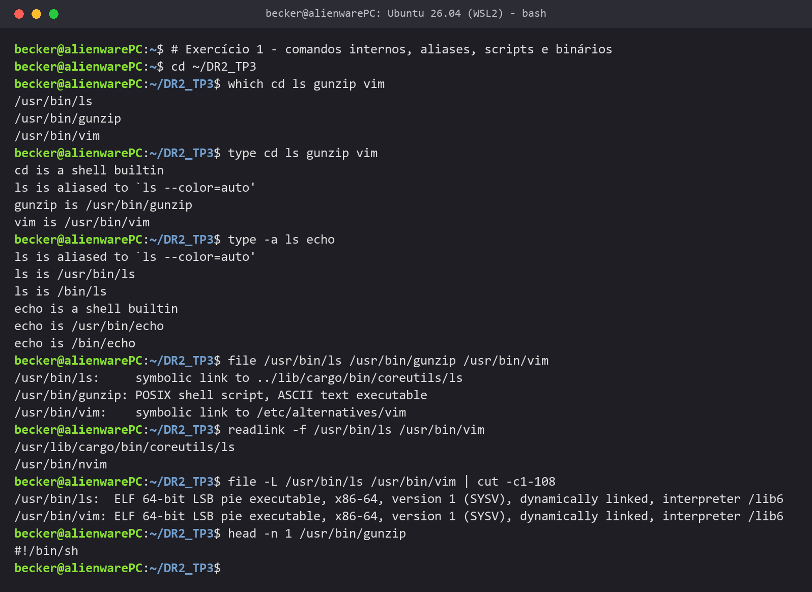

### Resposta

Escolhi quatro comandos para cobrir as quatro categorias:

- **`cd` é interno.** O `which` não devolveu nada e o `type` respondeu *shell builtin*. Ele precisa ser interno: um processo filho não consegue mudar o diretório do shell pai.
- **`ls` é alias e binário.** O `type -a` mostrou as camadas na ordem de busca: o alias `ls --color=auto` e depois `/usr/bin/ls`. O `readlink -f` revelou que `/usr/bin/ls` aponta para `/usr/lib/cargo/bin/coreutils/ls`: no Ubuntu 26.04 o coreutils padrão é o *uutils*, reescrito em Rust. O `file -L` confirma um ELF de 64 bits.
- **`gunzip` é script.** O `which` e o `type` o tratam como um arquivo qualquer do `PATH`; só o `file` mostra *POSIX shell script*, e a primeira linha é `#!/bin/sh`.
- **`vim` é binário atrás de dois links.** O caminho é `/usr/bin/vim` → `/etc/alternatives/vim` → `/usr/bin/nvim`, o sistema de alternativas do Debian. O `file` sem `-L` só diz *symbolic link*. A descoberta mudou uma decisão do Ex. 11: neste Ubuntu, `vim` abre o Neovim, então chamei o Vim original pelo nome `vim.basic`.

O `type -a echo` mostrou ainda o mesmo nome como builtin e como `/usr/bin/echo`; o builtin vence
porque é achado antes do `PATH`.

## Exercício 2: Estado global do sistema após a inicialização

### Enunciado

> 1. Execute systemctl status
> 2. Identifique serviços ativos e serviços inativos
> 3. Registre evidências relevantes observadas na saída do comando

### Teoria

O systemd é o PID 1 e gerencia *unidades*: serviços, sockets, montagens, timers e *targets*. Sem
argumento, o `systemctl status` mostra o estado do gerenciador inteiro e a árvore de cgroups com
cada serviço e os seus processos. Cada unidade tem três estados: LOAD (o arquivo foi lido), ACTIVE
(estado geral: active, inactive, failed) e SUB (detalhe: running, exited, dead).

### Comandos e execução

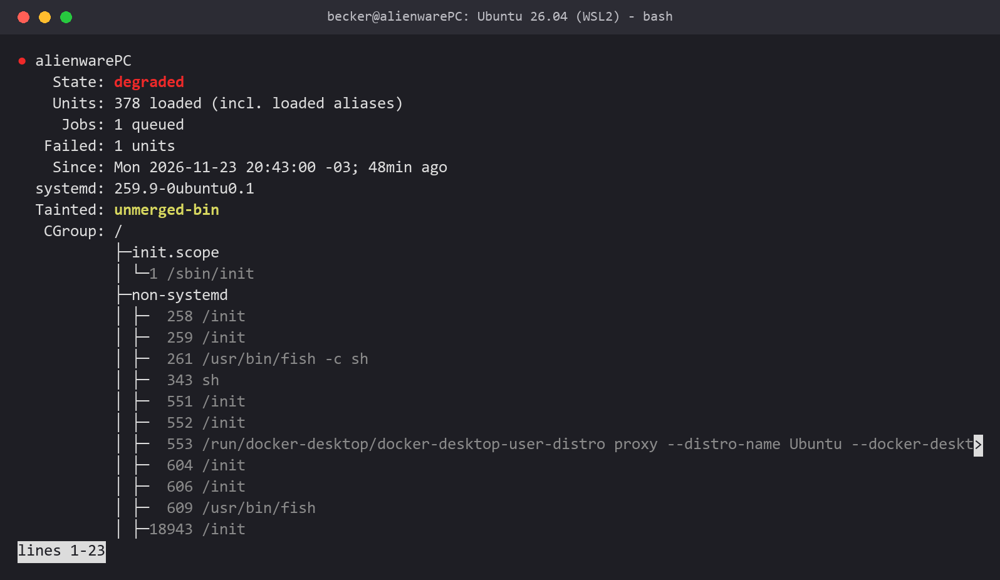

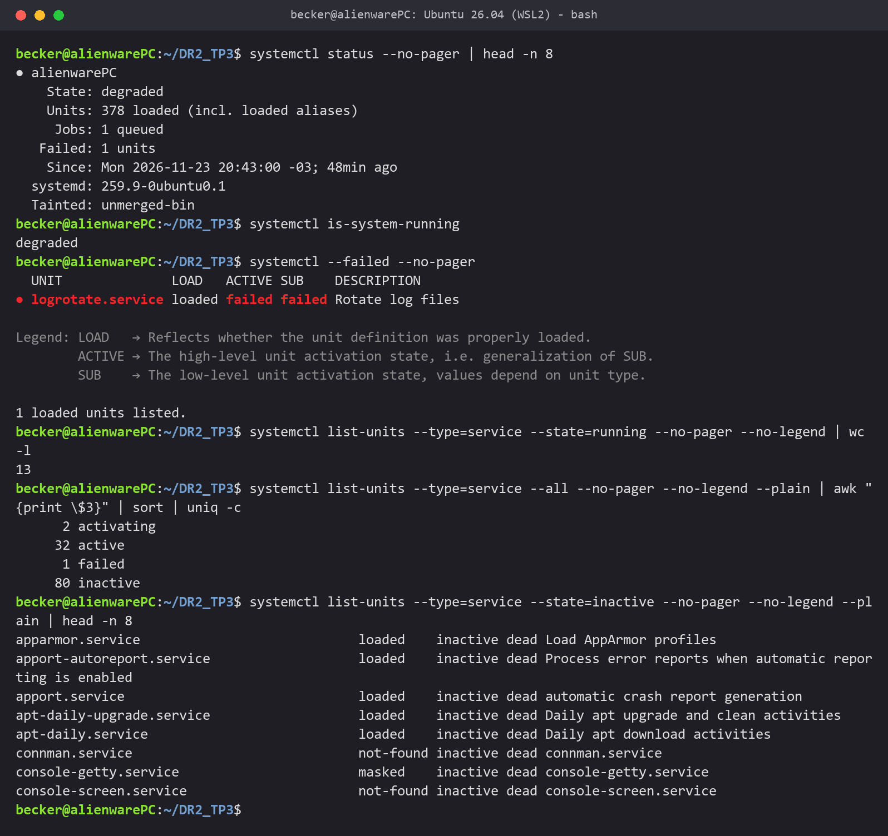

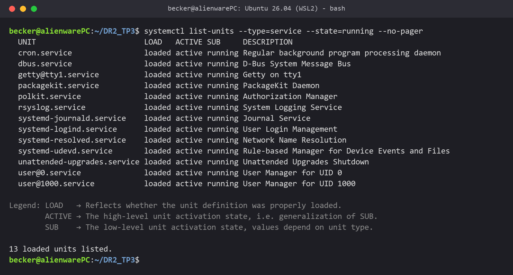

### Resposta

O estado global é **degraded**. Isso não quer dizer que o sistema está parado: o boot terminou e os
serviços essenciais rodam, mas há uma unidade com falha. O `systemctl --failed` aponta o
`logrotate.service`, que o Ex. 3 investiga no journal.

Contando os serviços com `awk` sobre a coluna ACTIVE, achei 32 ativos, 80 inativos, 1 com falha e 2
em *activating*, subindo naquele instante (são serviços do `apt` e do `man-db` disparados por
timers). Dos ativos, 13 estão *running* (processo vivo): cron, dbus, journald, logind, resolved,
udevd, rsyslog, polkit, packagekit e os gerenciadores de usuário `user@0` e `user@1000`, entre
outros. Os demais ativos estão *exited*: são *oneshot* que fizeram o seu trabalho no boot. Os inativos são unidades
carregadas mas paradas, como os serviços do `apt-daily`, que só sobem quando o timer dispara, e
unidades sem efeito no WSL, como o `apparmor`. A árvore de cgroups também mostra o grupo
`non-systemd`, com os processos `/init` do próprio WSL, que não pertencem a nenhuma unidade.

## Exercício 3: Análise cronológica do processo de boot

### Enunciado

> 1. Utilize journalctl -b para acessar os logs do boot atual
> 2. Filtre mensagens relacionadas ao systemd ou a serviços essenciais
> 3. Registre os trechos relevantes e os comandos utilizados

### Teoria

O `systemd-journald` guarda os logs do kernel e de todos os serviços num formato indexado. O
`journalctl -b` mostra só o boot atual, em ordem de tempo, e aceita filtros por campo: `_PID=1`
(mensagens do próprio systemd), `-u unidade` (um serviço) e `-p` (prioridade). Com
`-o short-monotonic`, cada linha leva os segundos desde o início do kernel. O `systemd-analyze` mede
o boot e mostra a cadeia de dependências.

### Comandos e execução

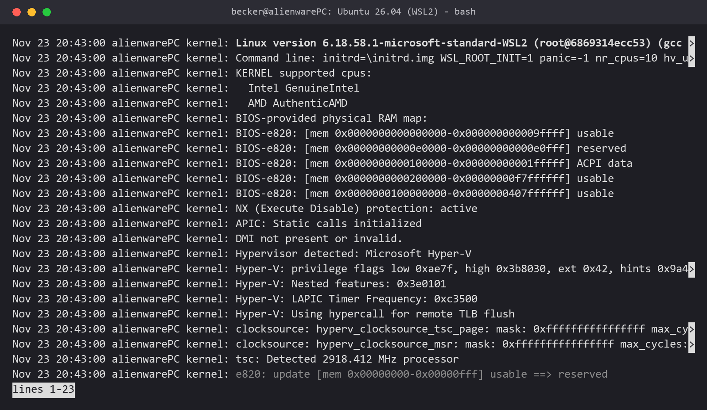

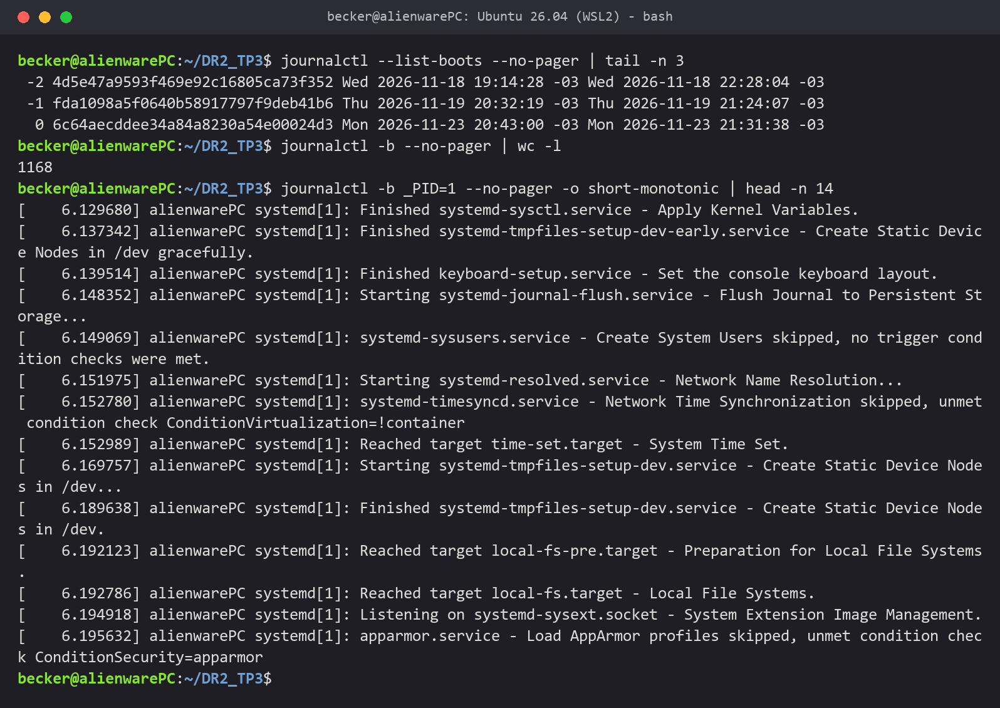

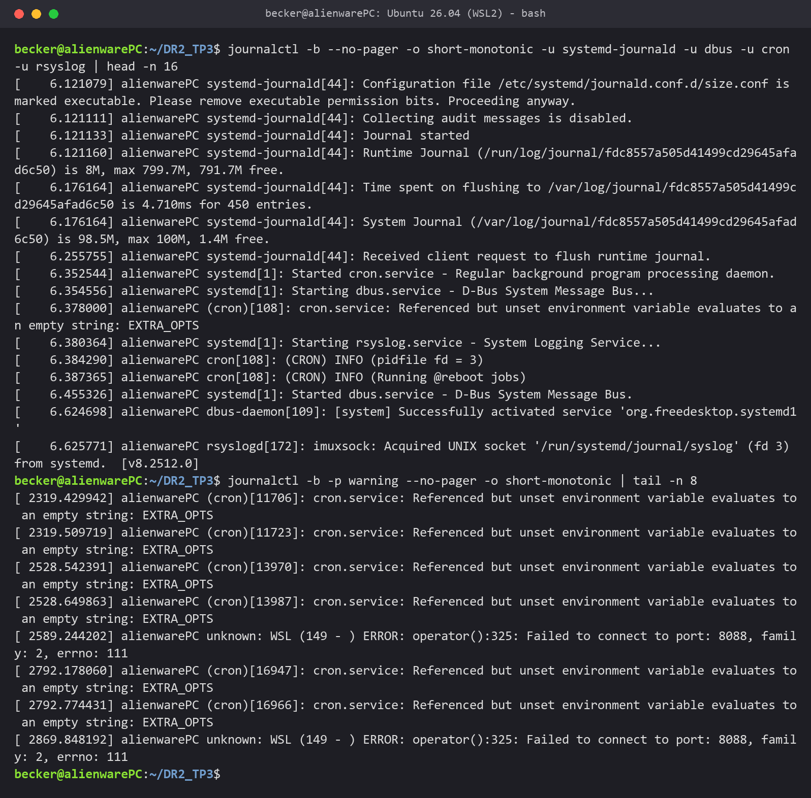

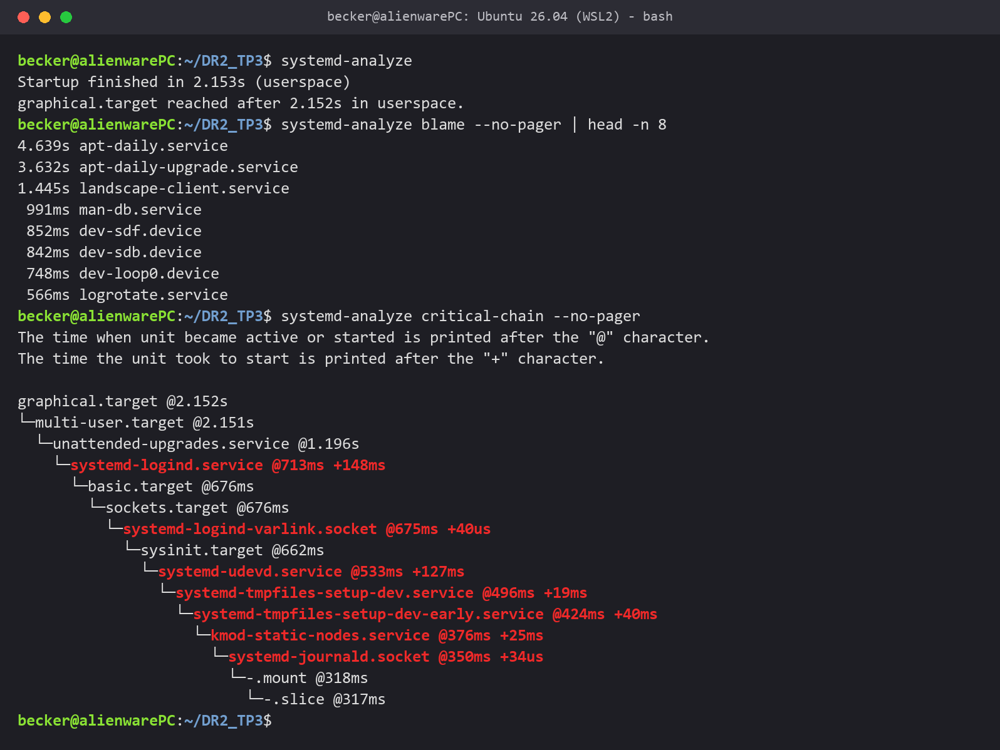

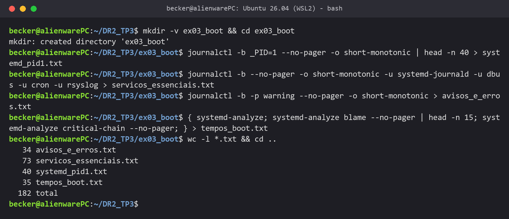

### Resposta

O journal do boot atual começa pelo kernel: versão, linha de comando, "Hypervisor detected:
Microsoft Hyper-V". Filtrando por `_PID=1`, aparece o systemd montando o sistema em ordem: aplica as
variáveis do kernel, cria os nós de `/dev`, sobe o `systemd-resolved`, alcança `local-fs.target` e
abre os sockets. Ele também registra o que **pulou**: o `systemd-timesyncd` não sobe porque a
condição `ConditionVirtualization=!container` não é atendida, e o `apparmor` não carrega no kernel
do WSL.

Nos serviços essenciais, a cronologia mostra as dependências. O `journald` sobe primeiro, porque é
ele que recebe os logs dos outros; o `cron`, o D-Bus e o `rsyslog` vêm em seguida, e o rsyslog pega
o socket `/run/systemd/journal/syslog` que o systemd lhe passa.

O filtro `-p warning` pede uma leitura crítica, porque o "boot atual" continua depois do boot. As
últimas linhas da Figura 7 foram causadas por mim: cada reinício do cron nos ensaios do Ex. 6
registra um aviso de variável `EXTRA_OPTS` vazia, e o WSL registrou erros na porta 8088, que o
container do Ex. 12 tinha publicado. A falha que interessa ao boot está no arquivo completo,
`ex03_boot/avisos_e_erros.txt`: o `logrotate.service` terminou com *exit-code*, o que explica o
estado *degraded* do Ex. 2. Lá aparecem também as falhas do `ubuntu-insights`, um serviço de
usuário que não acha `/root/.config`.

O `systemd-analyze` mede só o tempo de *userspace*: 2,15 s até o `graphical.target`. O `blame`
ordena as unidades pela duração e põe no topo o `apt-daily` (4,6 s), que roda por timer e não
atrasa o boot. O `critical-chain` mostra o que de fato atrasou o `graphical.target`: a cadeia que
passa por `systemd-logind` e `unattended-upgrades`. Os quatro trechos ficaram gravados em
`ex03_boot/`.

## Exercício 4: Inspeção do boot loader

### Enunciado

> 1. Execute bootctl status
> 2. Identifique informações sobre o loader e o kernel utilizado
> 3. Registre as principais evidências observadas

### Teoria

Num PC com UEFI, o firmware lê a partição de sistema EFI (ESP), executa o boot loader (systemd-boot
ou GRUB), que carrega o kernel e o initramfs e lhe passa a linha de comando. O `bootctl status`
mostra o firmware, o estado do Secure Boot, a ESP, o loader e as entradas de boot. O kernel guarda a
linha de comando que recebeu em `/proc/cmdline` e só cria `/sys/firmware/efi` se foi iniciado por
UEFI.

### Comandos e execução

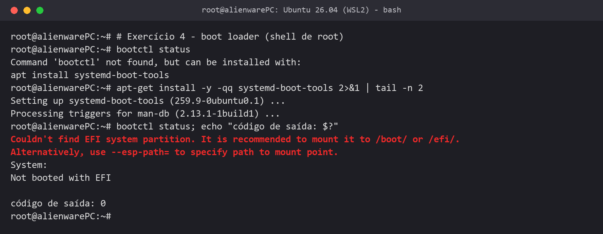

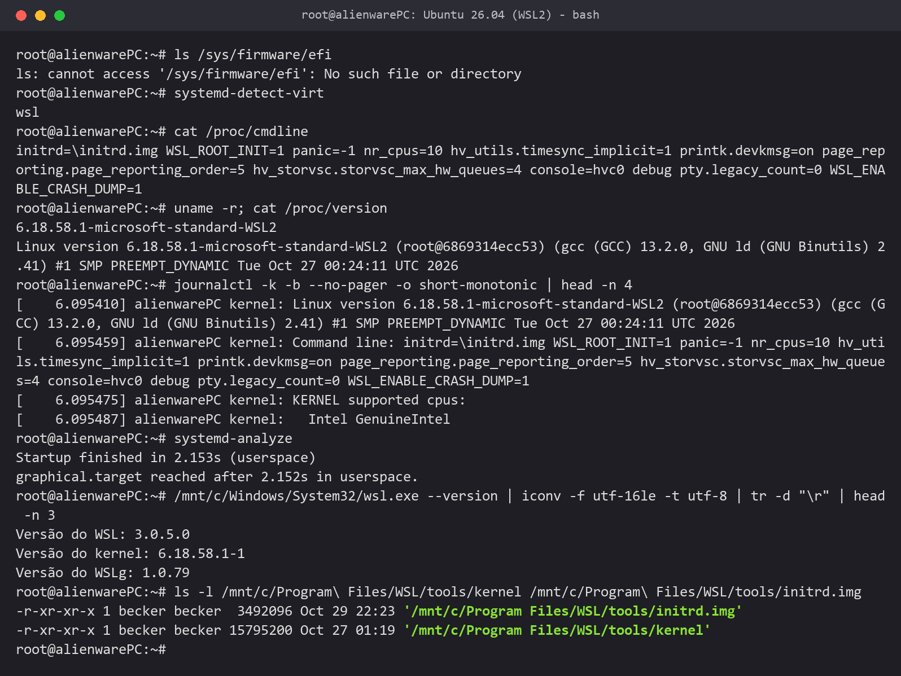

### Resposta

O `bootctl` não vem no Ubuntu 26.04; o próprio *command-not-found* indicou o pacote
`systemd-boot-tools`, que instalei. O `bootctl status` então respondeu que não achou a ESP e, na
seção *System*, **Not booted with EFI**. A ausência de `/sys/firmware/efi` confirma a mesma coisa.

A explicação é o WSL2: dentro da VM não há firmware nem boot loader. O serviço do WSL no Windows,
pelo Hyper-V, carrega o kernel direto na memória da VM e faz o papel que o systemd-boot teria. As
evidências do kernel usado são consistentes entre si:

- `uname -r` e `/proc/version`: `6.18.58.1-microsoft-standard-WSL2`, compilado com GCC 13.2.
- `/proc/cmdline`: a linha de comando montada pelo WSL, com `initrd=\initrd.img`, `console=hvc0` e opções do driver `hv_storvsc`. É a mesma linha que o kernel registra no início do journal.
- `wsl --version` no Windows informa o kernel 6.18.58.1, e o arquivo carregado é `C:\Program Files\WSL\tools\kernel`, com o `initrd.img` ao lado.
- `systemd-analyze` só mede *kernel* e *userspace*. Num boot UEFI apareceriam também *firmware* e *loader*.

O exercício não falhou: o `bootctl` é que provou, com evidência, que nesta máquina o boot loader
está fora do Linux.

## Exercício 5: Inspeção detalhada de serviços com systemd

### Enunciado

> 1. Escolha um serviço disponível no sistema
> 2. Utilize systemctl status <serviço>
> 3. Identifique PID, estado atual e logs recentes
> 4. Registre as informações obtidas

### Teoria

O `systemctl status <serviço>` junta três fontes: o arquivo da unidade (linha *Loaded*), o estado
que o systemd mantém (*Active*, *Main PID*, *Tasks*, *Memory*, *CGroup*) e as últimas linhas do
journal daquele serviço. O `systemctl show` devolve as mesmas propriedades no formato
`chave=valor`, bom para scripts.

### Comandos e execução

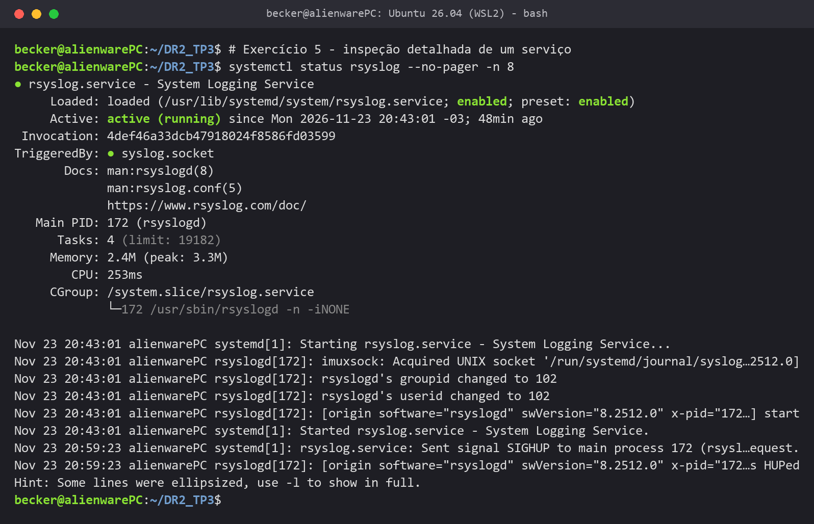

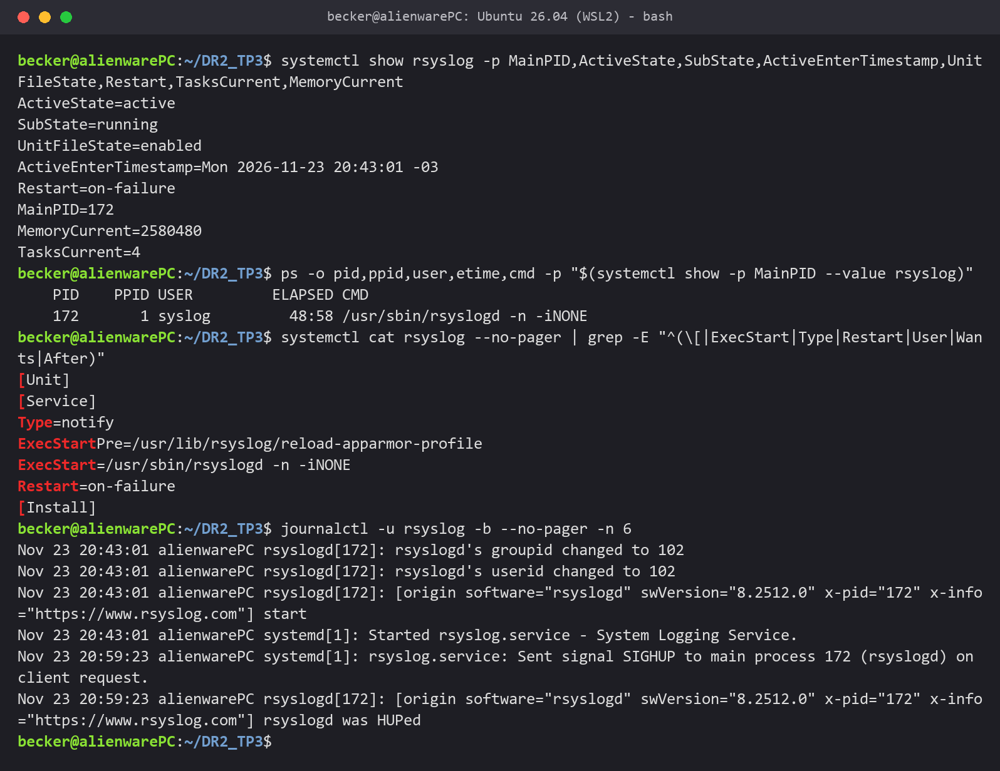

### Resposta

Escolhi o `rsyslog`, um serviço clássico de servidor que grava as mensagens do journal em
`/var/log/syslog`. O status mostrou:

- **PID:** 172 (`rsyslogd -n -iNONE`). O `ps` confirma que o pai é o PID 1 e que o processo roda como o usuário `syslog`, e não como root.
- **Estado atual:** `active (running)` desde o boot, `enabled` e com `Restart=on-failure`: se cair, o systemd o reinicia.
- **Consumo:** 4 *tasks* e cerca de 2,4 MB, contados pelo cgroup `/system.slice/rsyslog.service`.
- **Logs recentes:** a partida do daemon, a troca de usuário e grupo (`userid changed to 102`) e um `SIGHUP` recebido às 20:59, que é o `logrotate` pedindo para reabrir os arquivos de log.

A unidade usa `Type=notify`: o rsyslog avisa o systemd quando está pronto, e só então os
dependentes sobem.

## Exercício 6: Controle do ciclo de vida de serviços

### Enunciado

> 1. Escolha um serviço não crítico
> 2. Utilize systemctl start e systemctl stop
> 3. Utilize systemctl restart
> 4. Registre os efeitos observados em cada etapa

### Teoria

`stop` manda o sinal de término (SIGTERM) ao processo e espera que ele saia; `start` cria um
processo novo; `restart` faz os dois numa só operação. `reload` só pede ao processo que releia a
configuração, quando o serviço o suporta. Depois de cada passo, `is-active` e `show -p MainPID`
mostram o efeito.

### Comandos e execução

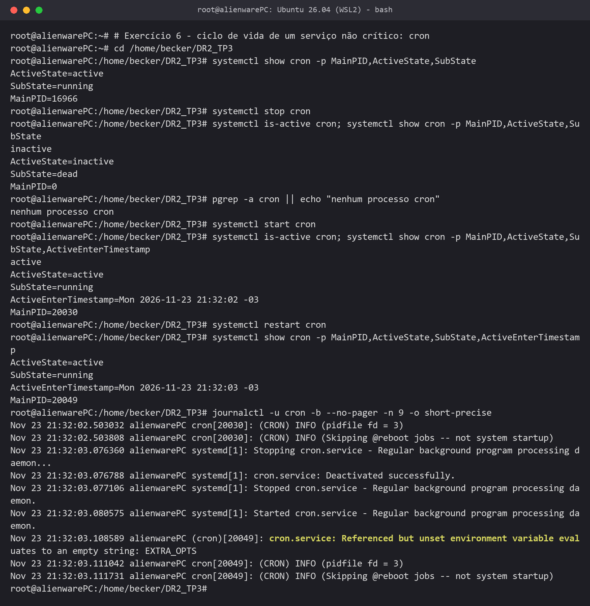

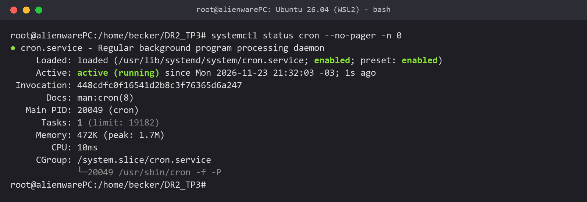

### Resposta

Escolhi o `cron` por não ser crítico: parado por alguns segundos, ele só adia tarefas agendadas.
Parar o `journald`, o `dbus` ou o `logind` derrubaria logs, comunicação entre serviços ou sessões.

| Etapa | Estado | MainPID | Efeito observado |
|---|---|---|---|
| Antes | active (running) | 16966 | o processo deixado pela captura anterior |
| `stop` | inactive (dead) | 0 | o `pgrep` não acha nenhum cron |
| `start` | active (running) | 20030 | processo novo, novo `ActiveEnterTimestamp` |
| `restart` | active (running) | 20049 | outro processo novo; o journal mostra *Stopping → Stopped → Started* |

Cada `start` cria um processo novo, por isso o PID muda. O `restart` faz a troca sem que eu precise
de dois comandos, e o tempo fora do ar fica menor. O cron termina como estava: ativo e habilitado.

## Exercício 7: Configuração de inicialização automática de serviços

### Enunciado

> 1. Escolha um serviço gerenciado pelo systemd
> 2. Utilize systemctl enable ou systemctl disable
> 3. Execute systemctl daemon-reload, se aplicável
> 4. Documente o estado final do serviço

### Teoria

Habilitar (`enable`) um serviço cria um link simbólico no diretório `.wants` do target indicado em
`[Install] WantedBy=`; no boot, o target "quer" o serviço e o inicia. `disable` remove o link. Nenhum
dos dois mexe no processo atual, a menos que se use `--now`. O `daemon-reload` faz o systemd reler os
arquivos de unidade: é necessário quando um arquivo é criado ou alterado.

### Comandos e execução

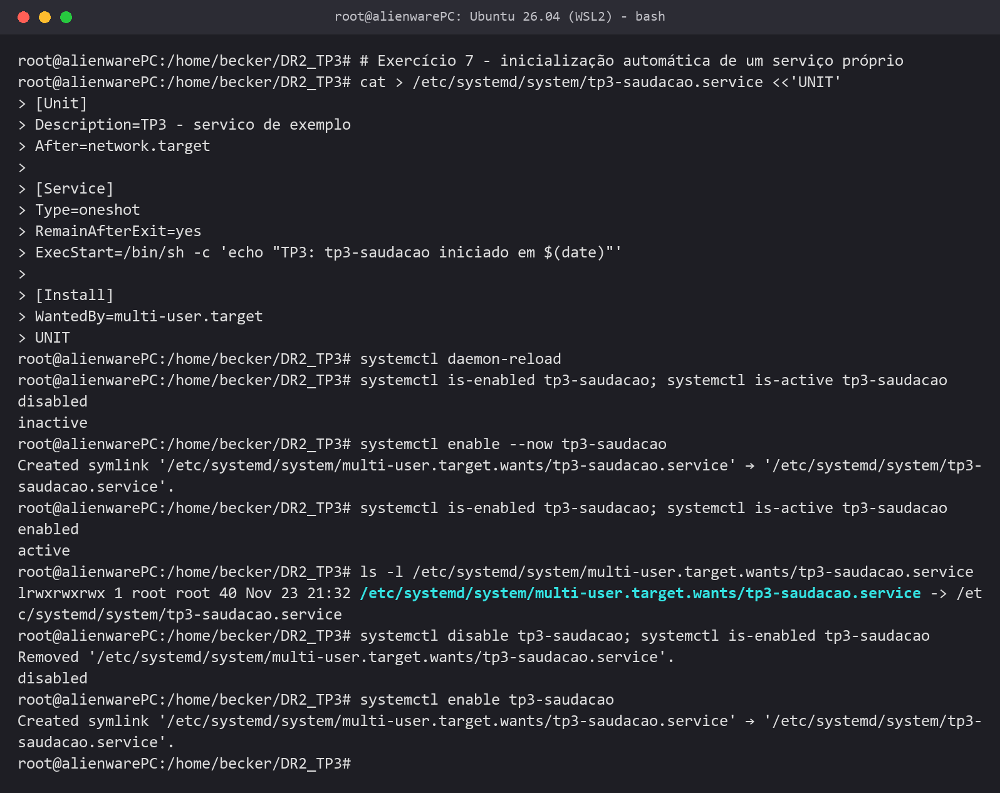

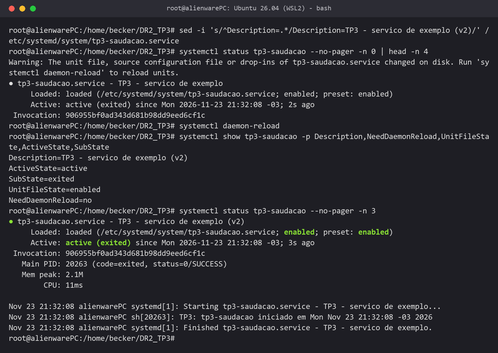

### Resposta

Criei uma unidade própria, `tp3-saudacao.service`, para não mexer no boot de um serviço do sistema
e para ter um caso real em que o `daemon-reload` se aplica. É um serviço *oneshot* com
`RemainAfterExit=yes`: roda um `echo` no boot e fica ativo sem processo.

- Depois de criar o arquivo, rodei `daemon-reload`, e o serviço passou a existir para o systemd, ainda `disabled` e `inactive`.
- O `enable --now` criou o link `multi-user.target.wants/tp3-saudacao.service` e já o iniciou.
- O `disable` removeu o link, mas o serviço continuou `active`: a configuração de boot e o estado atual são coisas separadas. O `enable` recriou o link.
- Alterei a `Description` com `sed`. O `systemctl status` avisou que o arquivo mudou no disco e pediu `daemon-reload`; depois da recarga, `NeedDaemonReload=no` e a descrição nova.

**Estado final:** `enabled` (sobe no próximo boot), `active (exited)`, descrição "TP3 - servico de
exemplo (v2)". Deixei o serviço habilitado de propósito, que é o estado documentado.

## Exercício 8: Gestão de pacotes e cadeia de suprimentos de software

### Enunciado

> 1. Utilize apt search ou yum search para localizar um pacote
> 2. Instale o pacote utilizando o gerenciador apropriado
> 3. Utilize apt show ou yum info para inspecionar metadados
> 4. Registre as informações obtidas

### Teoria

No Ubuntu, o `apt` baixa pacotes `.deb` de repositórios configurados em
`/etc/apt/sources.list.d/`. O `apt update` traz os índices, assinados com a chave do arquivo Ubuntu;
cada índice lista o hash SHA256 de cada pacote. Assim o `apt` garante a origem (só aceita índice
assinado por chave confiável) e a integridade (o `.deb` só é instalado se o hash bater). Ele também
resolve as dependências. O `dpkg` é a camada de baixo, que de fato instala e registra os arquivos.

### Comandos e execução

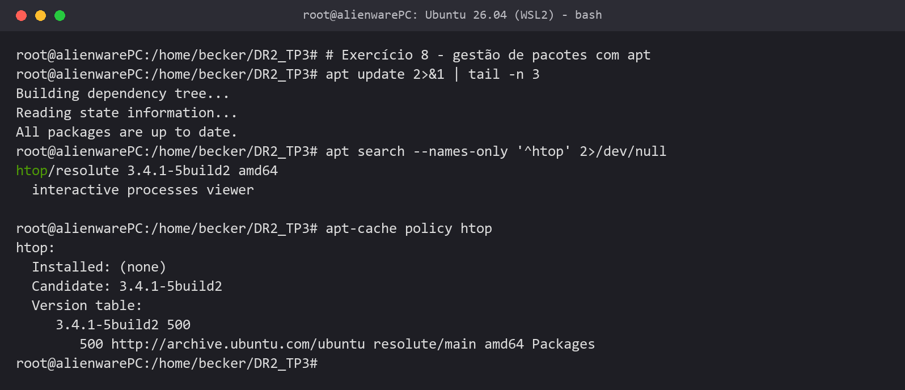

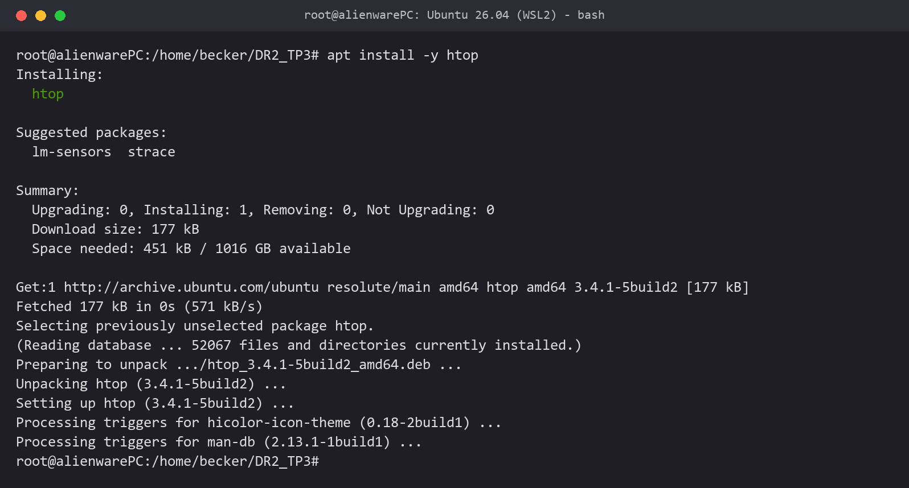

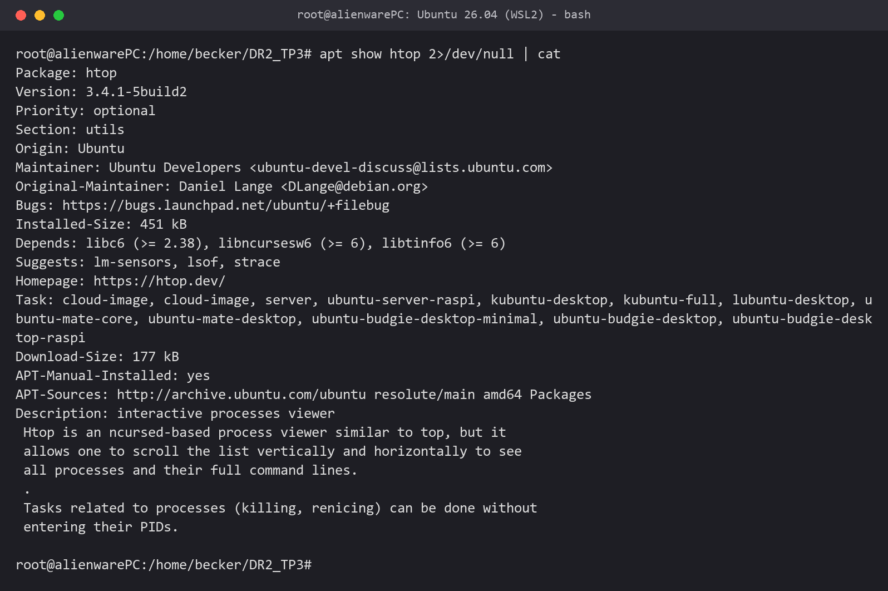

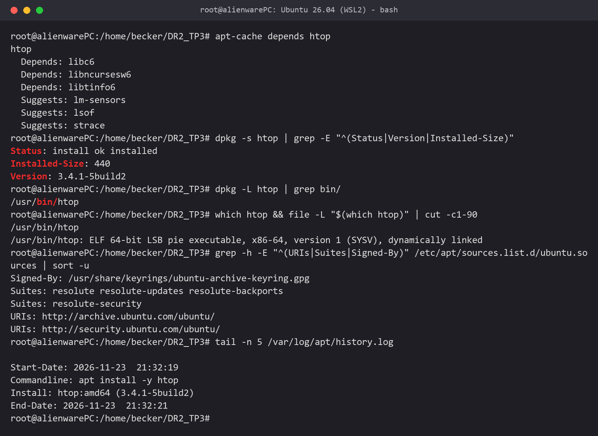

### Resposta

Procurei o `htop` com `apt search --names-only '^htop'`; a âncora `^` evita os pacotes que só
citam htop na descrição. Antes de instalar, o `apt-cache policy` mostrou *Installed: (none)* e de
onde viria cada versão. O `apt install` baixou o pacote, conferiu e o configurou.

O `apt show` e os comandos seguintes deram os metadados:

| Campo | Valor |
|---|---|
| Versão | 3.4.1-5build2 |
| Origem | `archive.ubuntu.com`, `resolute/main`, prioridade 500 |
| Mantenedor | Ubuntu Developers (o original é do Debian, `Original-Maintainer`) |
| Dependências | `libc6`, `libncursesw6`, `libtinfo6`, já presentes |
| Sugestões | `lm-sensors`, `lsof`, `strace` (não instaladas) |
| Tamanho | 177 kB baixados, 451 kB instalados |
| Binário | `/usr/bin/htop`, um ELF |

Na cadeia de suprimentos, o `ubuntu.sources` mostra o `Signed-By:
/usr/share/keyrings/ubuntu-archive-keyring.gpg`: o índice do repositório só é aceito se estiver
assinado com essa chave. O `/var/log/apt/history.log` registra o que foi instalado, por qual
comando e quando, o que dá rastreabilidade. O `htop` tem poucas dependências, todas da base, por
isso a instalação não trouxe nenhum pacote extra.

## Exercício 9: Introdução prática a containers via namespaces

### Enunciado

> 1. Execute lsns para visualizar namespaces ativos
> 2. Relacione namespaces a processos em execução
> 3. Registre observações técnicas

### Teoria

Um namespace dá a um grupo de processos uma visão própria de um recurso do kernel: `pid` (numeração
de processos), `net` (interfaces e rotas), `mnt` (montagens), `uts` (hostname), `ipc`, `user`,
`cgroup` e `time`. Cada processo aponta para os seus namespaces em `/proc/<PID>/ns`; dois processos
compartilham um namespace quando os links apontam para o mesmo inode. Um container é, no fundo, um
processo com namespaces próprios.

### Comandos e execução

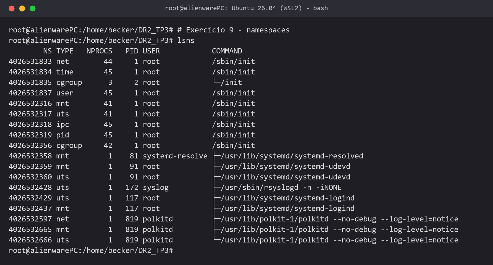

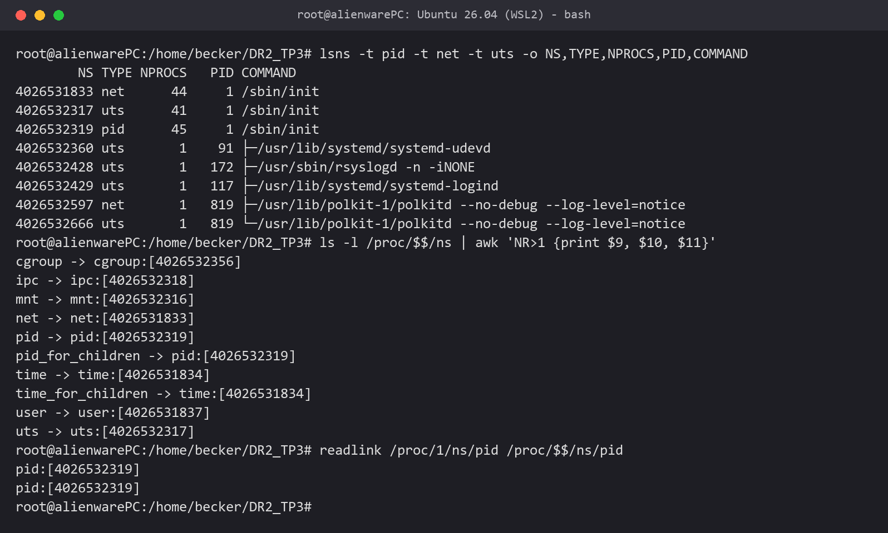

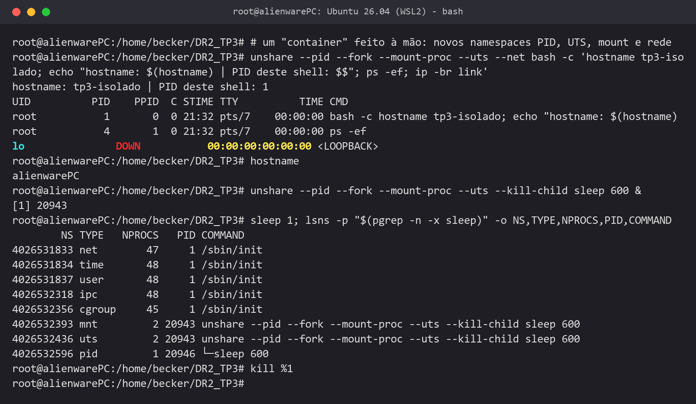

### Resposta

O `lsns` liga cada namespace a um processo pelas colunas PID e COMMAND, e NPROCS diz quantos estão
nele. Quase tudo roda nos namespaces do PID 1 (`/sbin/init`, o systemd). Os que têm outro PID foram
criados por serviços que se isolam: o `systemd-resolved` e outros usam opções como `PrivateTmp` e
`ProtectSystem`, que exigem um namespace de *mount* próprio. Pelo `readlink`, o meu shell e o PID 1
estão no mesmo `pid:[...]`.

Para relacionar namespaces e containers, usei o `unshare`, que cria namespaces novos e roda um
comando dentro deles:

- **UTS:** troquei o hostname para `tp3-isolado` lá dentro; fora, ele continuou `alienwarePC`.
- **PID:** o bash virou o PID 1, e o `ps -ef` só mostrou dois processos. O `--mount-proc` remontou o `/proc` para refletir o namespace novo.
- **NET:** a rede só tinha a interface `lo`, desligada. Não há como sair dali.

Com um `sleep` em segundo plano dentro de namespaces novos, o `lsns -p` mostrou `mnt` e `uts`
próprios, com dois processos (o `unshare` e o `sleep`), e um `pid` novo só com o `sleep`, que é o
PID 1 dele. Os outros tipos (`net`, `ipc`, `user`, `cgroup`, `time`) continuaram iguais aos do
sistema. Isso mostra que o isolamento é escolhido namespace por namespace. É o que o Docker faz no
Ex. 12, com todos os tipos de uma vez. Usei `--kill-child` para o `sleep` morrer junto com o
`unshare` no `kill %1`; sem a opção, ele ficaria órfão no namespace dele.

## Exercício 10: Uso de cgroups e controle de recursos

### Enunciado

> 1. Execute systemd-cgtop
> 2. Observe o uso de CPU e memória por grupos de controle
> 3. Registre evidências relevantes

### Teoria

Os cgroups (grupos de controle) agrupam processos para **contar** e **limitar** recursos: CPU,
memória, E/S e número de tarefas. No cgroup v2, cada grupo é um diretório em `/sys/fs/cgroup`, e os
limites são arquivos (`cpu.max`, `memory.max`). O systemd cria um cgroup para cada serviço, sessão e
*slice*; o `systemd-cgtop` é o "top" desses grupos.

### Comandos e execução

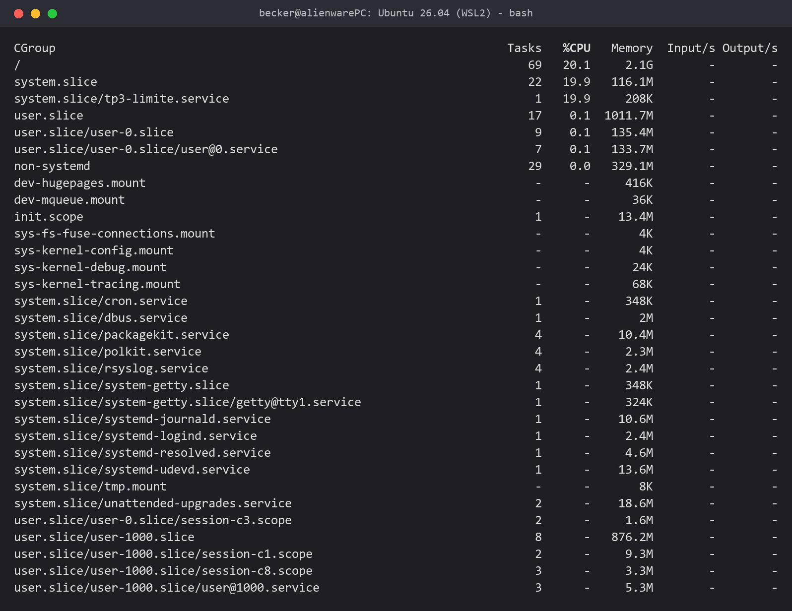

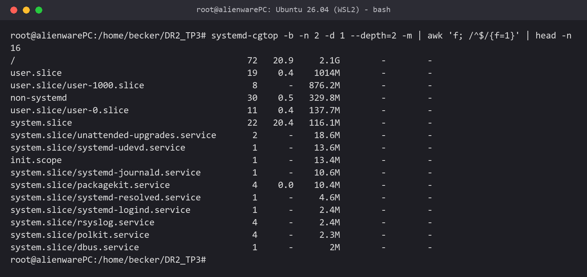

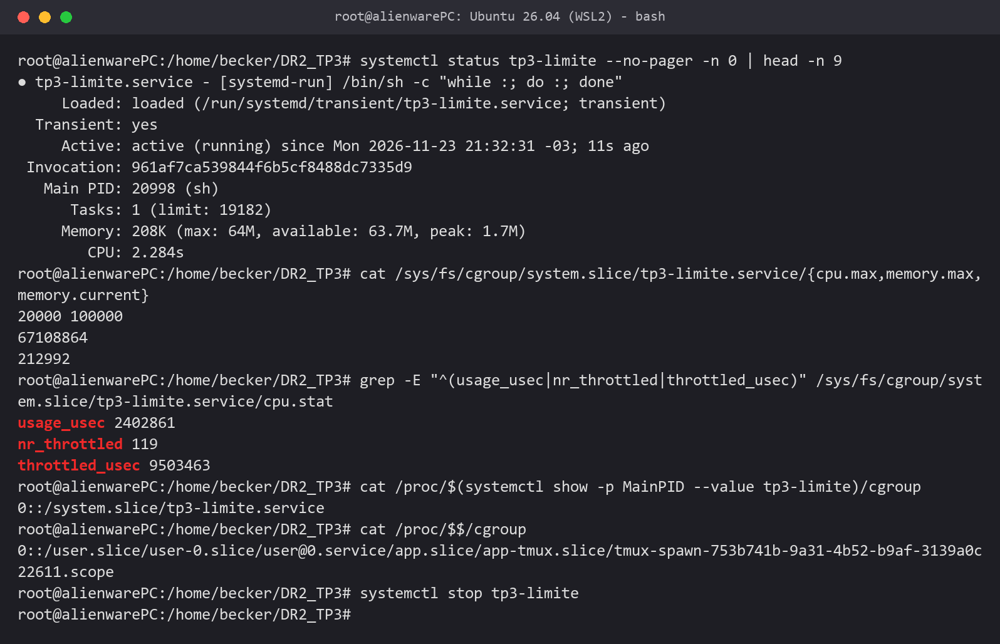

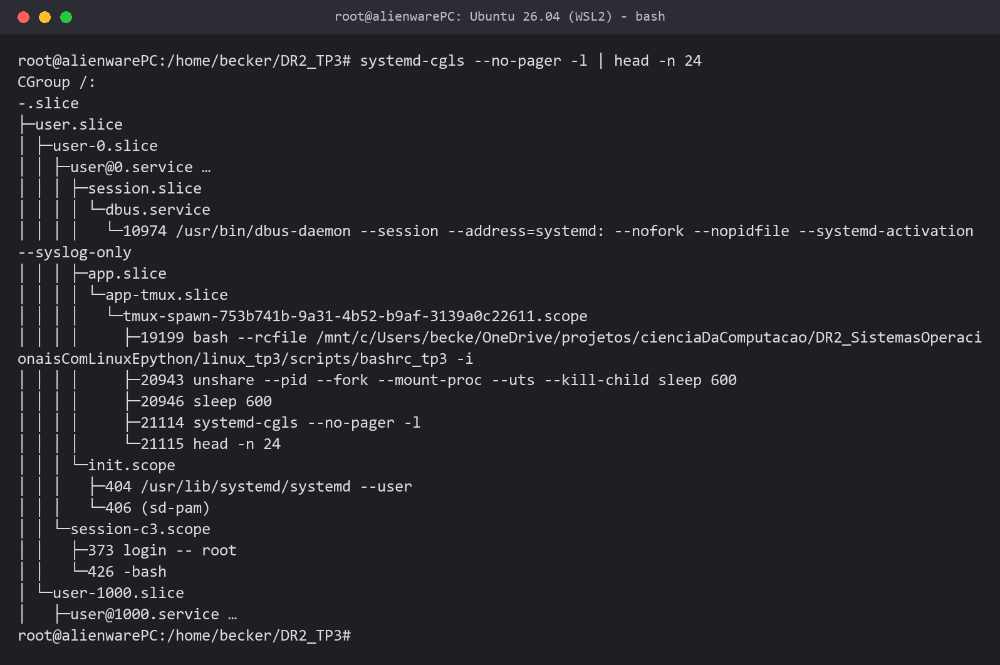

### Resposta

O sistema em repouso quase não usa CPU, e o `systemd-cgtop` ficaria cheio de zeros. Para ter um
consumo visível e controlado, criei com `systemd-run` um serviço transitório, o `tp3-limite`, que
roda um laço infinito com dois limites: `CPUQuota=20%` e `MemoryMax=64M`.

No `systemd-cgtop` (Figura 25), a raiz `/` soma o sistema inteiro, e logo abaixo aparecem
`system.slice` (serviços), `user.slice` (sessões), `non-systemd` (os processos do próprio WSL) e
`init.scope` (o PID 1). O `tp3-limite` aparece com **20% de CPU**, e não 100%, mesmo sendo um laço
infinito; a memória dele fica em poucas centenas de KiB, longe do limite. As colunas de CPU dos
outros serviços aparecem com `-` porque o systemd só liga a contabilidade de CPU nos grupos que
precisam dela, como o que tem `CPUQuota`.

Os limites viraram arquivos do cgroup v2: `cpu.max` é `20000 100000` (20 ms de CPU a cada 100 ms) e
`memory.max` é `67108864` (64 MiB). O `cpu.stat` mostra o `nr_throttled` crescendo: cada vez que o
laço gasta a sua cota, o kernel o pausa até o próximo período. O `/proc/<PID>/cgroup` mostra a que
grupo cada processo pertence: o laço em `/system.slice/tp3-limite.service` e o meu shell no
`user.slice`. Ordenado por memória (`-m`), o topo da lista fica com o `system.slice` e o grupo
`non-systemd` do WSL.

A relação com containers fecha com o Ex. 9: **namespaces decidem o que o processo vê; cgroups
decidem quanto ele pode usar.** O `docker run --memory 64m --cpus 0.5` do Ex. 12 escreve nesses
mesmos arquivos para o cgroup do container.

## Exercício 11: Manipulação avançada de arquivos com o editor vi

### Enunciado

> 1. Crie um arquivo chamado config_vi.txt utilizando exclusivamente o editor vi ou vim
> 2. No modo normal, navegue pelo arquivo e insira pelo menos 5 linhas de texto estruturado, simulando um arquivo de configuração
> 3. Utilize atalhos padrão do vi para: a) inserir texto em dois pontos distintos com comandos diferentes (i, a, o ou O); b) copiar (yank) uma linha e colá-la em outra posição; c) apagar uma linha inteira no modo normal; d) desfazer e refazer uma alteração
> 4. Utilize um comando de busca (/) para localizar um termo no arquivo
> 5. Utilize um comando de substituição para alterar todas as ocorrências de um termo
> 6. Salve o arquivo e saia do editor utilizando comandos explícitos do vi
> 7. Documente, em vi_operacoes.txt, os comandos e atalhos usados e a finalidade de cada operação

### Teoria

O vi é modal. No **modo normal**, cada tecla é um comando: mover (`G`, `$`, `j`), copiar (`yy`),
colar (`p`), apagar (`dd`), desfazer (`u`) e refazer (`Ctrl-r`). Os comandos `i`, `a`, `o` e `O`
entram no **modo de inserção** em pontos diferentes: antes do cursor, depois dele, numa linha nova
abaixo e numa linha nova acima. `Esc` volta ao modo normal. O `:` abre a **linha de comando**, para
salvar (`:w`), sair (`:q`) e substituir (`:%s/velho/novo/g`); a `/` busca.

### Comandos e execução

Como o Ex. 1 mostrou, neste Ubuntu `vi` e `vim` abrem o Neovim. Para usar o Vim original, abri o
arquivo com `vim.basic config_vi.txt` (Vim 9.1). Liguei `:set number hlsearch` para os prints
mostrarem os números de linha e o termo buscado.

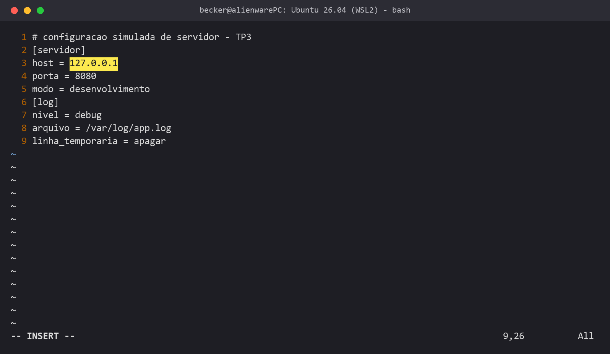

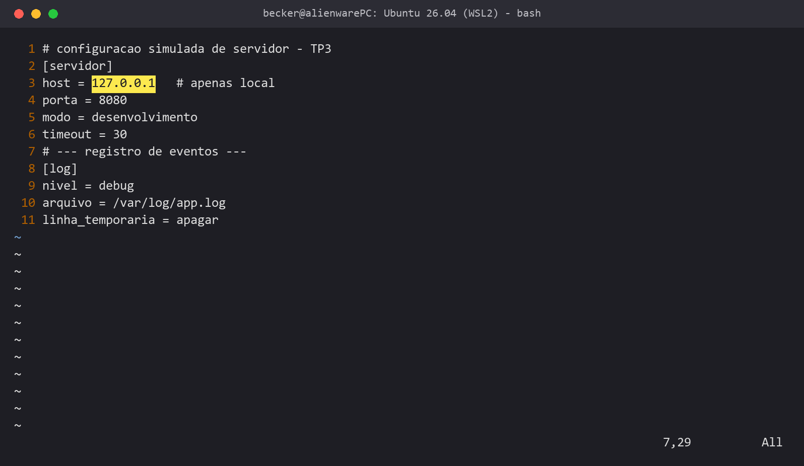

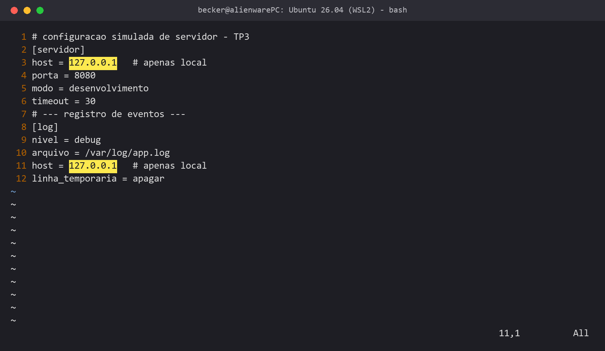

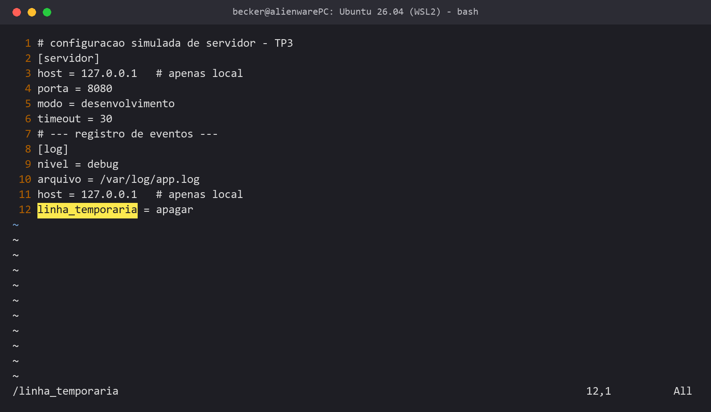

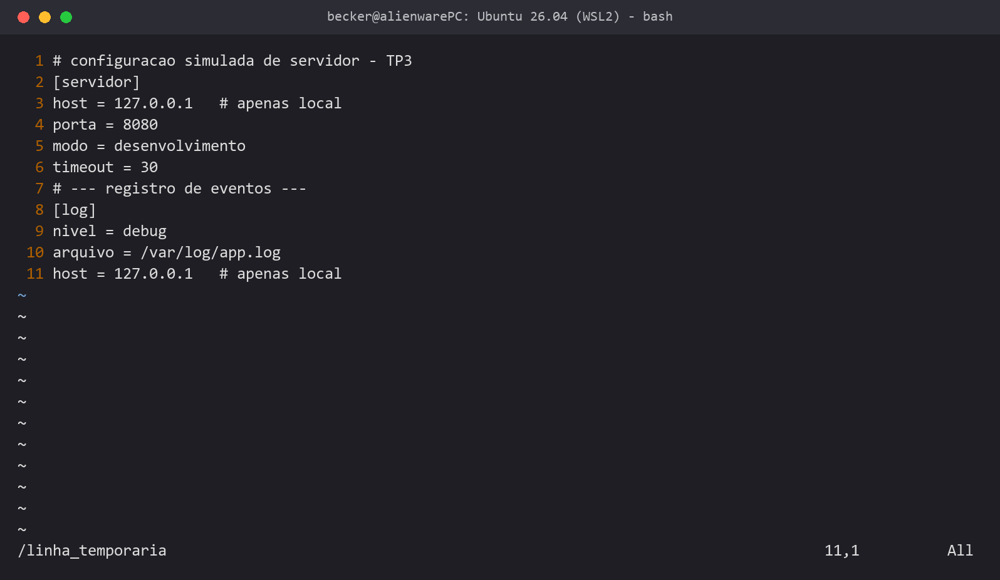

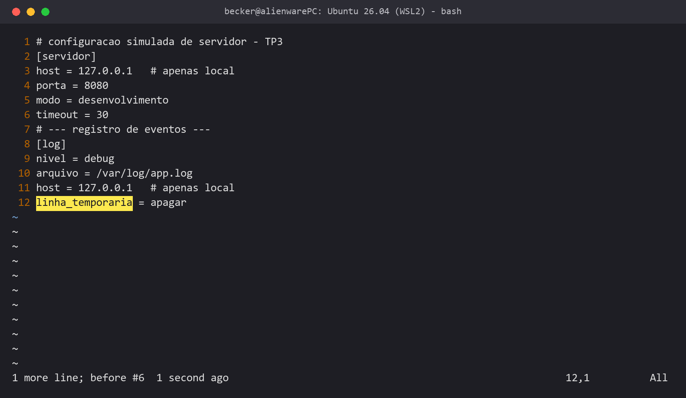

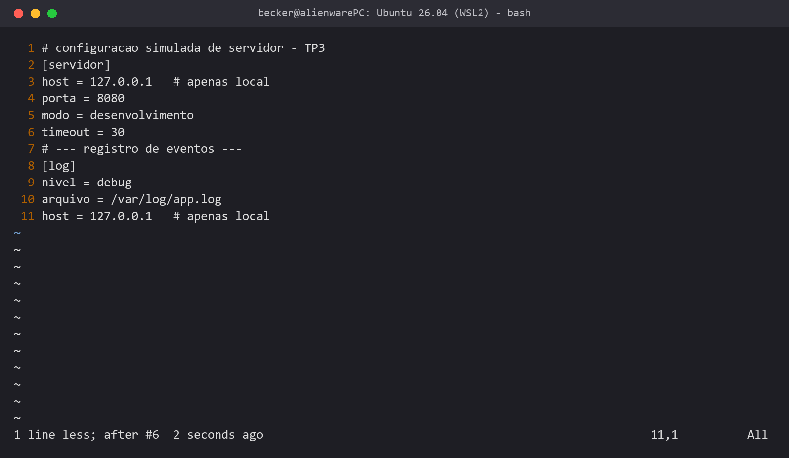

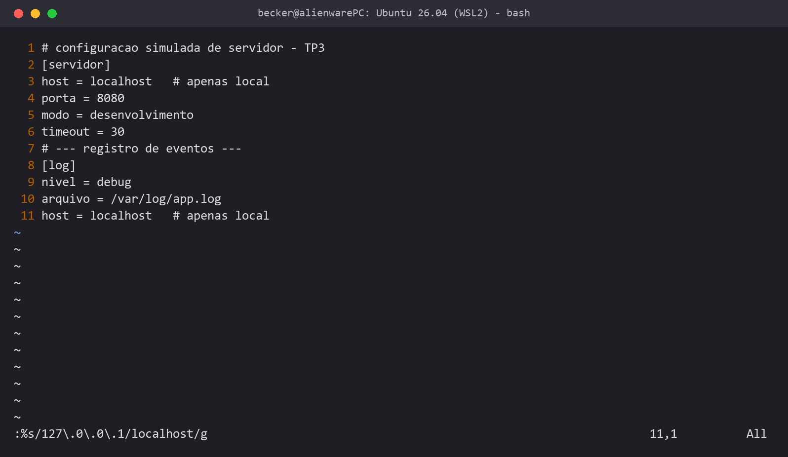

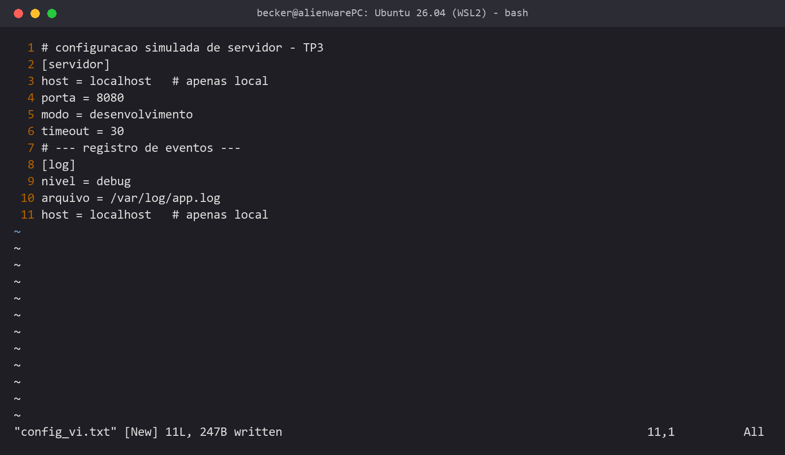

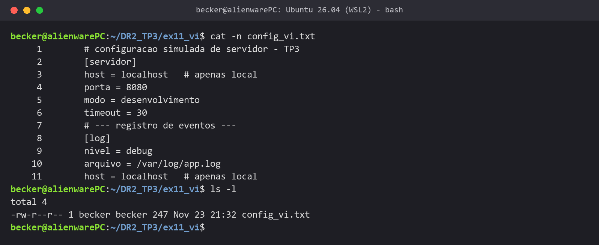

### Resposta

Simulei um arquivo de configuração com duas seções, `[servidor]` e `[log]`, e executei cada operação
pedida:

- **Inserção em pontos distintos:** `i` para as nove linhas iniciais; `$a` para acrescentar `# apenas local` no fim da linha do host; `o` para abrir `timeout = 30` abaixo da linha 5; e `O` para abrir o comentário `# --- registro de eventos ---` acima de `[log]`.
- **Yank e paste:** `3G` e `yy` copiaram a linha do host; `10G` e `p` a colaram abaixo de `arquivo = ...`, na seção `[log]`.
- **Busca e remoção:** `/linha_temporaria` levou o cursor até a linha marcada para sair, e `dd` a apagou.
- **Undo e redo:** `u` trouxe a linha de volta e `Ctrl-r` a apagou de novo. A barra inferior do Vim confirma cada passo.
- **Substituição:** `:%s/127\.0\.0\.1/localhost/g` trocou as duas ocorrências do endereço, e o Vim respondeu *2 substitutions on 2 lines*. Escapei os pontos (`\.`), porque sem a barra o ponto casa qualquer caractere.
- **Salvar e sair:** `:w` gravou o arquivo e `:q` fechou o editor. O `:q` só sai se não houver alteração pendente, o que confirma que tudo foi salvo.

Nas figuras 29 a 31, o `127.0.0.1` aparece realçado antes de qualquer busca nesta sessão. É o
`hlsearch` mostrando a última busca guardada pelo Vim em `~/.viminfo`, de um ensaio anterior do
exercício: o Vim lembra o histórico de buscas entre sessões.

O `cat -n` depois de sair mostra o arquivo final com 11 linhas. O `vi_operacoes.txt` traz a tabela
de cada comando, o modo em que foi usado e a sua finalidade.

## Exercício 12: Construção e execução de um container Docker

### Enunciado

> 1. Crie um Dockerfile simples para uma aplicação mínima
> 2. Utilize docker build para gerar uma imagem
> 3. Execute a imagem com docker run
> 4. Utilize docker ps e docker images para inspecionar o ambiente
> 5. Registre todo o processo de forma organizada

### Teoria

Uma imagem Docker é um conjunto de camadas de sistema de arquivos mais os metadados de execução; o
`Dockerfile` descreve como montá-la, uma instrução por camada. Um container é um processo iniciado a
partir da imagem, com namespaces próprios (Ex. 9) e limites de cgroup (Ex. 10). Ele vive enquanto o
seu PID 1 vive.

### Comandos e execução

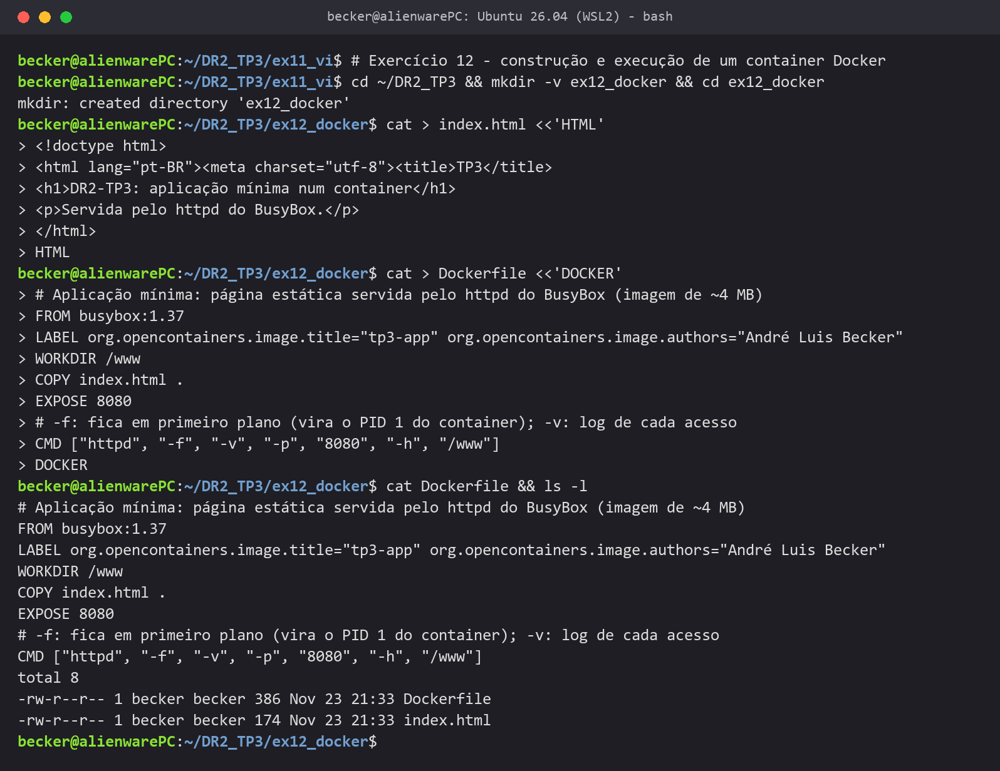

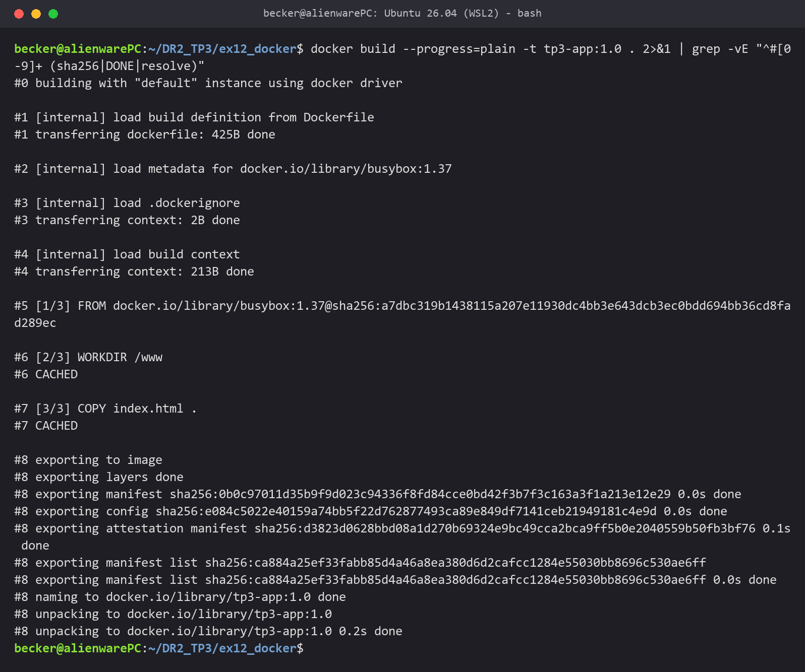

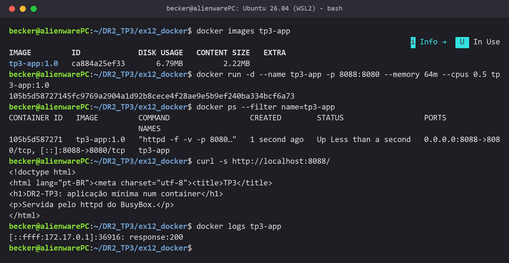

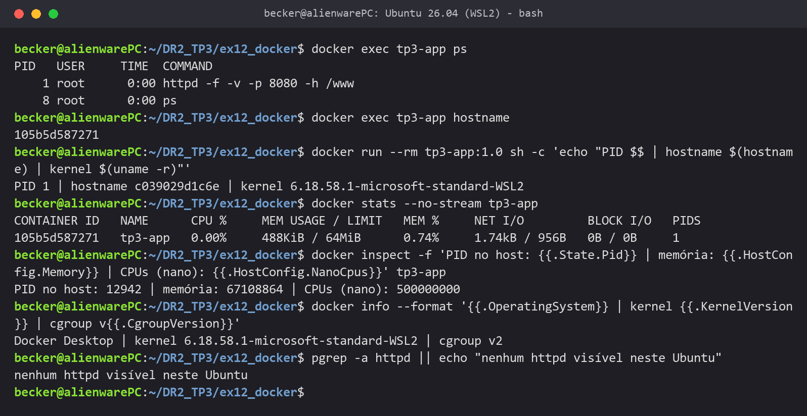

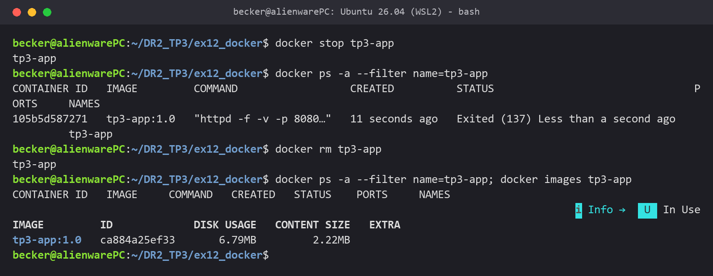

### Resposta

A aplicação mínima é uma página estática servida pelo `httpd` do BusyBox. Escolhi a imagem
`busybox:1.37` porque já traz o servidor e tem poucos megabytes. O Dockerfile tem seis instruções:
`FROM`, `LABEL`, `WORKDIR`, `COPY`, `EXPOSE` e `CMD`. O `CMD` roda o `httpd -f`, em primeiro plano,
porque é esse processo que mantém o container vivo.

O processo, na ordem:

1. **`docker build -t tp3-app:1.0 .`** gerou a imagem. Com `--progress=plain`, os passos aparecem numerados: `FROM`, `WORKDIR` e `COPY` geram camadas; `LABEL`, `EXPOSE` e `CMD` só gravam metadados.
2. **`docker images tp3-app`** mostra a imagem `1.0` com 2,22 MB de conteúdo (6,79 MB em disco), quase tudo da base BusyBox.
3. **`docker run -d --name tp3-app -p 8088:8080 --memory 64m --cpus 0.5`** subiu o container em segundo plano, com a porta 8088 do Windows/WSL ligada à 8080 do container e com limites de cgroup.
4. **`docker ps`** mostrou o container *Up* e a porta publicada. O `curl` recebeu a página, e o `docker logs` registrou o acesso.
5. **`docker stop`** e **`docker rm`** pararam e removeram o container; a imagem continua disponível.

O `docker stop` levou cerca de 10 segundos e o container saiu com o código **137** (128 + 9, SIGKILL).
O motivo é o namespace PID: o `httpd` é o PID 1 do container, e o kernel não aplica a ação padrão
dos sinais ao PID 1 de um namespace. O SIGTERM do `docker stop` foi ignorado, e o Docker mandou
SIGKILL depois do prazo. Num serviço real, isso se resolve com um processo de init no container
(`docker run --init`) ou tratando o SIGTERM na aplicação.

A figura 42 liga o Docker aos dois exercícios anteriores. Dentro do container, o `ps` só mostra o
`httpd` como PID 1, e o hostname é o ID do container: são os namespaces PID e UTS. O `uname -r` dá
o mesmo kernel do Ubuntu, porque container não é VM. O `docker stats` mostra o limite de 64 MiB, que
é o `memory.max` do cgroup do container. Por fim, o `docker info` mostra que o motor é o Docker
Desktop, que roda numa distribuição interna da mesma VM do WSL2. Por isso o `pgrep` não acha o
`httpd` neste Ubuntu: o container está em outro conjunto de namespaces, que esta distribuição não
enxerga.

## Atendimento à rubrica

| Critério | Onde está |
|---|---|
| Diferencia comandos internos, scripts e binários executáveis | Ex. 1: `cd` (builtin), `ls` (alias e ELF), `gunzip` (script com shebang), `vim` (links até o ELF) |
| Inspeciona o processo de inicialização do Linux | Ex. 2 (estado global), 3 (journal do boot, `systemd-analyze`) e 4 (`bootctl`, `/proc/cmdline`) |
| Gerencia serviços utilizando systemd | Ex. 5 (status), 6 (stop, start, restart) e 7 (unidade própria, enable, disable, daemon-reload) |
| Utiliza corretamente ferramentas de gestão de pacotes | Ex. 8 (`apt search`, `install`, `show`, `apt-cache policy`, `dpkg`) e Ex. 4 (pacote achado pelo command-not-found) |
| Relaciona namespaces e cgroups ao funcionamento de containers | Ex. 9 (`lsns`, `unshare`), 10 (`systemd-cgtop`, limites) e 12 (PID 1, hostname e limites do container) |
| Cria e executa containers Docker | Ex. 12: Dockerfile, build, run, ps, images, logs, stop e rm |
| Utiliza o editor vi para manipular arquivos | Ex. 11: inserção com `i`, `a`, `o` e `O`, `yy`/`p`, `dd`, `u`/`Ctrl-r`, `/`, `:%s`, `:w` e `:q` |
| Justifica decisões técnicas com base em evidências | Apresentação e respostas: `vim.basic` (Ex. 1), cron como não crítico (Ex. 6), unidade própria (Ex. 7), Not booted with EFI (Ex. 4), Docker Desktop (Ex. 12) |
| Organiza e documenta os artefatos produzidos | `~/DR2_TP3` com um `.txt` por exercício (Figura 44) e o anexo deste documento |

## Anexo: arquivos de evidência

Conteúdo integral dos arquivos gravados em `~/DR2_TP3`, cuja organização a Figura 44 mostra.

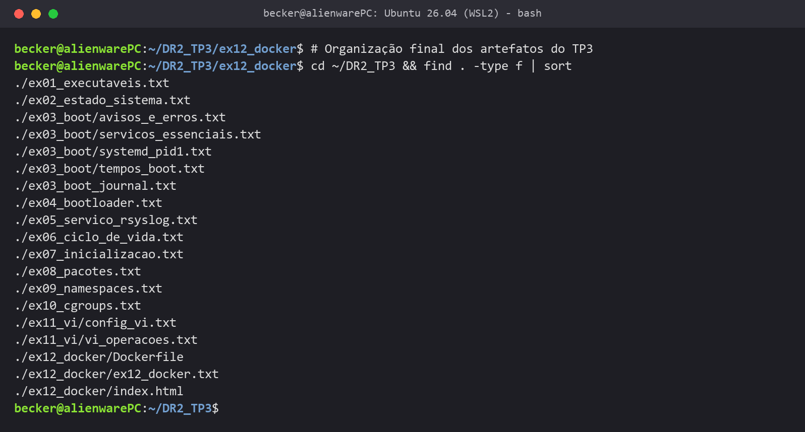

<!-- arquivo: ex01_executaveis.txt -->
<!-- arquivo: ex02_estado_sistema.txt -->
<!-- arquivo: ex03_boot_journal.txt -->
<!-- arquivo: ex03_boot/systemd_pid1.txt -->
<!-- arquivo: ex03_boot/servicos_essenciais.txt -->
<!-- arquivo: ex03_boot/avisos_e_erros.txt -->
<!-- arquivo: ex03_boot/tempos_boot.txt -->
<!-- arquivo: ex04_bootloader.txt -->
<!-- arquivo: ex05_servico_rsyslog.txt -->
<!-- arquivo: ex06_ciclo_de_vida.txt -->
<!-- arquivo: ex07_inicializacao.txt -->
<!-- arquivo: ex08_pacotes.txt -->
<!-- arquivo: ex09_namespaces.txt -->
<!-- arquivo: ex10_cgroups.txt -->
<!-- arquivo: ex11_vi/config_vi.txt -->
<!-- arquivo: ex11_vi/vi_operacoes.txt -->
<!-- arquivo: ex12_docker/Dockerfile -->
<!-- arquivo: ex12_docker/index.html -->
<!-- arquivo: ex12_docker/ex12_docker.txt -->

<!-- so-github -->
| Arquivo | Exercício |
|---|---|
| [ex01_executaveis.txt](../evidencias/DR2_TP3/ex01_executaveis.txt) | 1 |
| [ex02_estado_sistema.txt](../evidencias/DR2_TP3/ex02_estado_sistema.txt) | 2 |
| [ex03_boot_journal.txt](../evidencias/DR2_TP3/ex03_boot_journal.txt) e [ex03_boot/](../evidencias/DR2_TP3/ex03_boot) | 3 |
| [ex04_bootloader.txt](../evidencias/DR2_TP3/ex04_bootloader.txt) | 4 |
| [ex05_servico_rsyslog.txt](../evidencias/DR2_TP3/ex05_servico_rsyslog.txt) | 5 |
| [ex06_ciclo_de_vida.txt](../evidencias/DR2_TP3/ex06_ciclo_de_vida.txt) | 6 |
| [ex07_inicializacao.txt](../evidencias/DR2_TP3/ex07_inicializacao.txt) | 7 |
| [ex08_pacotes.txt](../evidencias/DR2_TP3/ex08_pacotes.txt) | 8 |
| [ex09_namespaces.txt](../evidencias/DR2_TP3/ex09_namespaces.txt) | 9 |
| [ex10_cgroups.txt](../evidencias/DR2_TP3/ex10_cgroups.txt) | 10 |
| [ex11_vi/](../evidencias/DR2_TP3/ex11_vi) (`config_vi.txt`, `vi_operacoes.txt`) | 11 |
| [ex12_docker/](../evidencias/DR2_TP3/ex12_docker) (`Dockerfile`, `index.html`, `ex12_docker.txt`) | 12 |
<!-- /so-github -->

## Referências

- SHOTTS, W. *The Linux Command Line*. 2. ed. San Francisco: No Starch Press, 2019. Caps. 5, 12 e 14.
- TANENBAUM, A. S.; BOS, H. *Sistemas Operacionais Modernos*. 4. ed. São Paulo: Pearson, 2016. Caps. 1 e 10.
- FREEDESKTOP.ORG. *systemd: System and Service Manager*. Documentação de `systemctl(1)`, `systemd.unit(5)`, `journalctl(1)`, `bootctl(1)`, `systemd-cgtop(1)` e `systemd-run(1)`.
- KERNEL.ORG. *Control Group v2*; páginas de manual `namespaces(7)`, `unshare(1)` e `lsns(8)`.
- DEBIAN. *apt(8)*, *apt-cache(8)*, *dpkg(1)* e *sources.list(5)*.
- VIM. *Vim reference manual*: `:help insert`, `:help yank`, `:help undo-redo`, `:help :substitute`.
- DOCKER. *Dockerfile reference* e *Docker CLI reference* (`docker build`, `run`, `ps`, `images`, `stats`).
- MICROSOFT. *Documentação do WSL: kernel do WSL 2 e systemd*.
